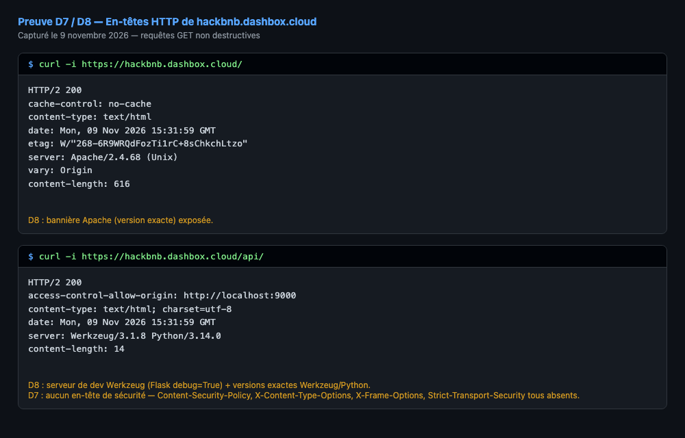

# HackBNB — Synthèse technique des vulnérabilités (D1-D8)

**Date d'investigation :** 9, 11 et 13 novembre 2026
**Environnement testé :** pré-production (`https://hackbnb.dashbox.cloud`)
**Outils utilisés :** Burp Suite Community Edition (Repeater, Intruder), curl, Gitleaks

Trace écrite des vulnérabilités identifiées dans le rapport de pentest (annexe 5), reproduites et prouvées en environnement de pré-production.

---

## D1 — Injection SQL sur `/api/rooms/`

| Champ | Valeur |
|---|---|
| **CWE** | CWE-89 (SQL Injection) |
| **OWASP Top 10** | A03:2021 – Injection |
| **Référence test** | OWASP WSTG-INPV-05 |
| **Localisation** | `back/api/rooms/rooms_api.py`, ligne 18 |

**Code vulnérable**
```python
if "category" in request.args:
    category = request.args["category"]
    rooms = Room.query.filter(text(f"category = '{category}'")).all()
```

**Mécanisme** : le paramètre `category` est concaténé directement dans une requête SQL brute (`sqlalchemy.text`) sans requête préparée ni paramètre bindé, permettant l'injection de clauses SQL arbitraires dans la condition `WHERE`.

### Preuve 1 — Bypass logique de la clause WHERE

Payload : `x' OR '1'='1'-- -`

| Requête | Réponse |
|---|---|
|  |  |

`HTTP/2 200 OK`, `Content-Length: 3691` — 10 rooms renvoyées, alors qu'une catégorie inexistante (`x`) devrait renvoyer `[]` (liste vide). Preuve du contrôle de la logique SQL.

### Preuve 2 — Exfiltration de données hors périmètre (table `users`)

Payload : `x' UNION SELECT id, name, email, password_hash, 0, 0, 0, 0 FROM users-- -`

| Requête | Réponse |
|---|---|
|  |  |

Les colonnes sélectionnées sont mappées positionnellement sur le modèle `Room` par l'ORM SQLAlchemy (`id→id`, `name→title`, `email→city`, `password_hash→price`). 3 comptes extraits :

| id | name | email | password_hash |
|---|---|---|---|
| 1 | John Doe | john@doe.com | XX *(valeur de seed, pas un hash réel — cf. note ci-dessous)* |
| 2 | test | test@test.com | 5f4dcc3b5aa765d61d8327deb882cf99 |
| 3 | Pain perdu vendredi ! | clubquisine@guardiaschool.fr | 86afb02a7da647a644c07deaccd233e6 |

*Note : le compte `John Doe` est initialisé dans `database/seed.py` avec `password_hash="XX"` en dur (donnée de démo, pas un hash MD5 valide) — seuls les comptes 2 et 3 illustrent le problème réel de hachage MD5 non salé.*

**Impact** : compromission totale de la base de données (lecture arbitraire de toute table via UNION SELECT), incluant les comptes utilisateurs et leurs hash de mot de passe.

**Niveau de risque (échelle ANSSI)** : Exploitation **Facile** × Impact **Critique** = **Critique** (conforme à l'évaluation du rapport de pentest, annexe 5, item D1).

**Recommandation** : remplacer la requête SQL brute par l'ORM standard (`Room.query.filter_by(category=category)`) ou par une requête paramétrée bindée (`text("category = :cat").bindparams(cat=category)`). Cf. OWASP SQL Injection Prevention Cheat Sheet.

**Observation complémentaire (hors périmètre D1-D8, à ajouter aux recommandations finales)** : les hash extraits font 32 caractères hexadécimaux → format **MD5**, algorithme de hachage obsolète et non salé (`5f4dcc3b5aa765d61d8327deb882cf99` = MD5 connu de `"password"`). Recommandation : migrer vers bcrypt/argon2 avec sel.

---

## D2 — Path Traversal sur `/api/uploads/`

| Champ | Valeur |
|---|---|
| **CWE** | CWE-22 (Improper Limitation of a Pathname to a Restricted Directory) |
| **OWASP Top 10** | A01:2021 – Broken Access Control |
| **Référence test** | OWASP WSTG-ATHZ-01 (Testing Directory Traversal File Include) |
| **Localisation** | `back/api/uploads/uploads_api.py`, ligne 7 |

**Code vulnérable**
```python
@uploads_api.route('/')
def get_upload():
   return send_file('uploads/' + request.args.get("name"))
```

**Mécanisme** : le paramètre `name` est concaténé directement à un chemin de base (`uploads/`) sans filtrage des séquences `../`, permettant de sortir du répertoire prévu.

### Preuve 1 — Lecture du code source applicatif

Payload : `../app.py`

| Requête | Réponse |
|---|---|
|  |  |

`HTTP/2 200 OK`, `Content-Type: text/x-python`, `Content-Disposition: inline; filename=app.py` — code source complet de `back/app.py` renvoyé en clair.

### Preuve 2 — Lecture fichier système (hors périmètre applicatif)

Payload : `../../../../../etc/passwd`

| Requête | Réponse |
|---|---|
|  |  |

`HTTP/2 200 OK`, `Content-Type: application/octet-stream`, `Content-Disposition: inline; filename=passwd` — fichier système `/etc/passwd` renvoyé en clair. Preuve que la faille dépasse largement le périmètre applicatif (accès au système de fichiers du serveur/conteneur).

**Impact** : lecture arbitraire de tout fichier accessible par le process Flask (code source, configuration, fichiers système), bien au-delà du répertoire `uploads/` prévu.

**Niveau de risque (échelle ANSSI)** : Exploitation **Facile** × Impact **Critique** = **Critique** (conforme annexe 5, item D2).

**Recommandation** : valider/assainir le paramètre `name` (whitelist de caractères, `os.path.basename()`), et vérifier via `os.path.realpath()` que le chemin résolu reste bien dans le répertoire `uploads/`.

---

## D3 — SSRF sur `/api/bookings/<reference>/checkout-lines`

| Champ | Valeur |
|---|---|
| **CWE** | CWE-918 (Server-Side Request Forgery) |
| **OWASP Top 10** | A10:2021 – Server-Side Request Forgery |
| **Localisation** | `back/services/stripe.py`, lignes 31-36 + `back/api/bookings/bookings_api.py`, ligne 44 |

**Code vulnérable**
```python
# bookings_api.py
checkout_session_id = request.args.get("checkout_session_id")  # non contrôlé
return jsonify(get_checkout_lines(checkout_session_id))

# stripe.py
def get_checkout_lines(checkout_session_id):
    url = f"https://api.stripe.com/v1/checkout/sessions/{checkout_session_id}/line_items"
    session = requests.Session()
    session.auth = (os.getenv('STRIPE_API_KEY'), "")  # clé secrète du serveur
    return session.get(url).json()["data"]
```

**Mécanisme** : le paramètre `checkout_session_id` est injecté tel quel dans l'URL interrogée auprès de l'API Stripe, authentifiée avec la clé secrète du marchand. En injectant une séquence `../../` suivie d'un `#` (pour tronquer le `/line_items` final), on détourne la requête vers n'importe quel endpoint Stripe (condition : la réservation utilisée doit être payée, sinon `422`).

### Preuve — Détournement vers un endpoint liste (fuite cross-clients)

Réservation utilisée : `57TDGUK1` (`is_paid: true`)
Payload : `checkout_session_id=../../checkout/sessions%23`

| Requête | Réponse |
|---|---|
|  |  |

`HTTP/2 200 OK` — la réponse contient les sessions de paiement Stripe de **tous les clients**, pas seulement celles liées à la réservation `57TDGUK1`.

**Finding critique additionnel** : une des sessions retournées expose, dans son champ `success_url`, le `checkout_confirmation_secret` **en clair** d'une autre réservation (`VM4UXB28`, `payment_status: "unpaid"`) :
```
https://hackbnb.dashbox.cloud/booking/VM4UXB28?checkout_confirmation_secret=2cac7e5ac3ef2115fc18c06bbc5cdbeac325c1966f50184f0ed7b7e3ad1d61c265220cc0eaf9c9933de7883324d8efdd008ad8fe79a9624c818a802a8933f1c5
```
→ **chaînage direct D3 → D4** : cette SSRF permet de récupérer le secret de confirmation de *n'importe quelle* réservation d'*un autre client*, sans avoir besoin de le bruteforcer (cf. D4). C'est un vecteur d'exploitation encore plus efficace que le bruteforce décrit dans le rapport de pentest pour D4.

**Impact** : exposition de données de paiement et de secrets de confirmation appartenant à d'autres clients, via une requête authentifiée avec la clé API du marchand détournée vers un périmètre non prévu par l'application.

**Niveau de risque (échelle ANSSI)** : Exploitation **Modérée** × Impact **Critique** = **Critique** (conforme annexe 5, item D3).

**Recommandation** : valider `checkout_session_id` contre un format strict (regex `^cs_[a-zA-Z0-9_]+$`), et/ou vérifier que la session Stripe récupérée correspond bien au `stripe_checkout_session_id` déjà enregistré pour la réservation concernée.

---

## D4 — Génération vulnérable du secret de confirmation de paiement

| Champ | Valeur |
|---|---|
| **CWE** | CWE-330 (Use of Insufficiently Random Values) |
| **OWASP Top 10** | A02:2021 – Cryptographic Failures |
| **Localisation** | `back/api/bookings/bookings_api.py`, lignes 93-95 |

**Code vulnérable**
```python
random_string = str(int(time.time()))  # timestamp UNIX à la seconde près
checkout_confirmation_secret = hashlib.sha512(random_string.encode('utf-8')).hexdigest()
```

**Mécanisme** : le secret de confirmation de paiement n'est qu'un hash SHA-512 du timestamp serveur (en secondes). Un attaquant connaissant l'heure approximative de création d'une réservation (via le header `Date` de la réponse HTTP, par exemple) peut bruteforcer ce secret en quelques dizaines/centaines de tentatives, et confirmer le paiement d'une réservation **sans jamais payer**.

**Méthodologie** : Burp Intruder, payload type `Numbers` (plage ciblée autour du timestamp de création, pas de l'heure courante — le secret est fixé au moment de la création et ne change pas), règle de traitement `Hash → SHA-512` appliquée au payload, position marquée sur la valeur de `confirmationSecret` dans le corps JSON de `POST /bookings/<reference>/confirm-checkout`.

### Preuve — Bruteforce réussi

Réservation créée : `XFX6Q5I2` (sans jamais ouvrir le `checkout_url` ni effectuer de paiement réel)
Fenêtre testée : timestamp centre (± marge) autour de l'heure de création — secret retrouvé exactement au timestamp `1794408723` (= heure de création exacte, aucun décalage)

| Requête | Réponse |
|---|---|
|  |  |

Le tableau de résultats Intruder montre la requête #91 en `200 OK` (longueur de réponse 166, `{"success": true}`), distincte des dizaines de tentatives en `422` (longueur 207) juste au-dessus.

### Preuve — Confirmation sans paiement réel

```
GET /api/bookings/XFX6Q5I2 HTTP/2
```

| Requête | Réponse |
|---|---|
|  |  |

`"is_paid": true` — la réservation de 340€ (`room-1`, 2 nuits) est confirmée comme payée, sans qu'aucun paiement Stripe réel n'ait été effectué (le `checkout_url` n'a jamais été ouvert).

**Impact** : contournement complet du paiement — confirmation arbitraire de n'importe quelle réservation sans transaction financière réelle.

**Niveau de risque (échelle ANSSI)** : Exploitation **Modérée** × Impact **Critique** = **Critique** (conforme annexe 5, item D4).

**Recommandation** : générer le secret avec une source d'aléa cryptographiquement sûre (`secrets.token_hex(32)` en Python), indépendante de toute information prévisible comme un timestamp.

**Observation complémentaire** : combiné à D3 (SSRF), ce secret peut aussi être lu directement dans le `success_url` d'une session Stripe d'un autre client (cf. finding D3), rendant le bruteforce ci-dessus même superflu pour un attaquant qui aurait déjà exploité D3.

---

## D5 — Exposition de l'adresse e-mail des hôtes dans les réponses API

| Champ | Valeur |
|---|---|
| **CWE** | CWE-359 (Exposure of Private Personal Information to an Unauthorized Actor) |
| **OWASP Top 10** | A01:2021 – Broken Access Control (*Excessive Data Exposure*, OWASP API3:2023) |
| **Référence test** | OWASP WSTG-INFO-05 (Review Webpage Content for Information Leakage) |
| **Localisation** | `back/api/users/users_models.py`, lignes 18-23 + `back/api/rooms/rooms_models.py`, ligne 35 |

**Code vulnérable**
```python
# back/api/users/users_models.py:18
def to_dict(self):
    return {
        "id": self.id,
        "name": self.name,
        "email": self.email,   # e-mail renvoyé sans restriction
    }

# back/api/rooms/rooms_models.py:34
if self.host_user:
    output["host"] = self.host_user.to_dict()
```

**Mécanisme** : la sérialisation publique d'une chambre (`Room.to_dict()`) embarque l'objet hôte complet, dont le `to_dict()` inclut l'adresse e-mail. Ce `to_dict()` est appelé par les routes publiques `GET /rooms/` et `GET /rooms/<room_id>` (`back/api/rooms/rooms_api.py`, lignes 22 et 35), ainsi que par `GET /bookings/<reference>` via `Booking.to_dict()` → `room.to_dict()` (`back/api/bookings/bookings_models.py`, ligne 36). Aucune authentification n'est requise.

### Preuve — Lecture de l'e-mail de l'hôte sans authentification

```bash
curl -s https://hackbnb.dashbox.cloud/api/rooms/1 | python3 -m json.tool
```

```json
{
    "id": 1,
    "title": "Nature, Spa & bien-être au Châtaignier",
    "host": {
        "email": "john@doe.com",
        "id": 1,
        "name": "John Doe"
    }
}
```


`HTTP/2 200 OK`, aucun cookie ni jeton envoyé : le champ `host.email` est renvoyé en clair. `GET /api/rooms/` renvoie le même objet pour les **10** chambres de la pré-production (toutes rattachées à l'hôte `john@doe.com`).

**Impact** : l'adresse e-mail est une donnée personnelle au sens du RGPD. Les hôtes de HackBNB ont des « profils sensibles du monde cyber » (cf. entretien, annexe 3). La fuite permet de collecter les e-mails de tous les hôtes en une requête, puis de les cibler (phishing, corrélation d'identités). Les conséquences restent isolées à cette donnée.

**Niveau de risque (échelle ANSSI)** : Exploitation **Facile** × Impact **Important** = **Majeur** (conforme annexe 5, item D5).

**Recommandation** : séparer la représentation publique de l'utilisateur de sa représentation privée, et n'utiliser que la première dans les sérialisations publiques.
```python
# users_models.py
def to_public_dict(self):
    return {"id": self.id, "name": self.name}

# rooms_models.py
if self.host_user:
    output["host"] = self.host_user.to_public_dict()
```
L'e-mail ne doit être renvoyé que par une route authentifiée (`/users/me`), à l'utilisateur concerné.

---

## D6 — Clé API Stripe présente dans d'anciens commits

| Champ | Valeur |
|---|---|
| **CWE** | CWE-798 (Use of Hard-coded Credentials), CWE-540 (Inclusion of Sensitive Information in Source Code) |
| **OWASP Top 10** | A07:2021 – Identification and Authentication Failures |
| **Outil** | Gitleaks (`gitleaks git .`, scan de tout l'historique : 31 commits) |
| **Localisation** | `back/services/stripe.py`, lignes 11 et 35 (commit `ef5503c`) + `docker-compose.yml`, ligne 10 (commit `4aec6cd`, toujours présente dans `HEAD`) |

**Code vulnérable**
```python
# back/services/stripe.py — commit ef5503c (Lucas Bridet, 24/03/2025, "feat: add Stripe payment integration")
stripe.api_key = "rk_test_51RhVfI2aoAWLbEQqd67veWGXyEfUURY...SWE0X008r1rAkXU"                 # ligne 11
session.auth = ("rk_test_51RhVfI2aoAWLbEQqd67veWGXyEfUURY...SWE0X008r1rAkXU", "")             # ligne 35
```
```yaml
# docker-compose.yml — commit 4aec6cd (Emma Roussel, 19/03/2025), toujours présent dans HEAD
environment:
  APP_ORIGIN_HOST: http://localhost:9000
  STRIPE_API_KEY: sk_test_51RhVfI2aoAWLbEQqUskEoID6RpBTEXO...IWLuBOs3                        # ligne 10
```

**Mécanisme** : deux clés Stripe ont été écrites en dur dans des fichiers versionnés. Le commit `9eeb41e` (Thomas Nguyen, 24/03/2025, *« fix: do not hardcode the Stripe API key »*) remplace la clé restreinte `rk_test_…` par `os.getenv('STRIPE_API_KEY')`, mais **sans réécrire l'historique** : la clé reste lisible dans le commit `ef5503c`. La correction a par ailleurs simplement déplacé le problème : la clé secrète `sk_test_…` est toujours en clair dans `docker-compose.yml`, dans la version actuelle du dépôt.

### Preuve 1 — Détection automatisée (Gitleaks)

```bash
gitleaks git . -f json -r gitleaks.json
# 31 commits scanned — leaks found: 113 (scan de main, avant l'ajout de cette synthèse)
```

Les 113 alertes se regroupent en **trois fuites distinctes** :

| Règle Gitleaks | Fichier | Commit | Secret |
|---|---|---|---|
| `stripe-access-token` | `back/services/stripe.py` (l. 11 et 35) | `ef5503c` | `rk_test_51RhVfI2…r1rAkXU` (clé restreinte, retirée du code mais présente dans l'historique) |
| `stripe-access-token` | `docker-compose.yml` (l. 10) | `4aec6cd` → `HEAD` | `sk_test_51RhVfI2…IWLuBOs3` (clé secrète, toujours présente) |
| `generic-api-key` (×111) | `apache.log` | `03e4a50` | `checkout_confirmation_secret` journalisés en clair (cf. observation complémentaire) |

Extrait du rapport JSON pour la clé secrète :
```json
{
  "RuleID": "stripe-access-token",
  "File": "docker-compose.yml",
  "StartLine": 10,
  "Commit": "4aec6cd799457718ab012c186fb29bb6fc3adc43",
  "Author": "Emma Roussel",
  "Date": "2025-03-19T15:30:25Z",
  "Message": "chore: implement Docker Compose deployment setup",
  "Entropy": 5.3875604
}
```

### Preuve 2 — Récupération manuelle dans l'historique Git

```bash
git log --format='%h %an %ad %s' --date=short -S 'rk_test' -- back/services/stripe.py
# 9eeb41e Thomas Nguyen 2025-03-24 fix: do not hardcode the Stripe API key
# ef5503c Lucas Bridet  2025-03-24 feat: add Stripe payment integration

git show 9eeb41e -- back/services/stripe.py
# -    stripe.api_key = "rk_test_51RhVfI2aoAWLbEQqd67veWGXyEfUURY…"
# +    stripe.api_key = os.getenv('STRIPE_API_KEY')
```

Le diff du « fix » affiche lui-même la clé supprimée : n'importe quelle personne ayant un accès en lecture au dépôt la récupère avec une seule commande Git.

*Validité des clés non testée : appeler l'API Stripe avec une clé divulguée sortirait du cadre non destructif de l'investigation. La faille D3 montre par ailleurs qu'une clé Stripe marchand est bien active côté serveur en pré-production.*

**Scénario d'exploitation** :
1. L'attaquant obtient un accès en lecture au dépôt (fuite, ancien collaborateur, dépôt rendu public, poste de développeur compromis).
2. Il extrait `STRIPE_API_KEY` de `docker-compose.yml`, ou la clé `rk_test_…` de l'historique.
3. Il appelle directement l'API Stripe avec cette clé : lister les sessions de paiement et les clients, créer ou rembourser des paiements, selon les droits de la clé.

**Impact** : une clé secrète (`sk_`) donne un accès complet à l'API Stripe du compte marchand (données de paiement de tous les clients, opérations financières). Une clé commitée est compromise de façon permanente : la retirer du code ne la révoque pas.

**Niveau de risque (échelle ANSSI)** : Exploitation **Difficile** × Impact **Critique** = **Majeur** (conforme annexe 5, item D6).
*Note : une fois l'accès au dépôt obtenu, l'extraction est triviale (Gitleaks, `git log -S`). La difficulté tient entièrement à l'obtention de cet accès.*

**Recommandation** :
1. **Révoquer et régénérer immédiatement** les deux clés (`sk_test_…` et `rk_test_…`) dans le dashboard Stripe. C'est la seule mesure qui neutralise la fuite.
2. Sortir la clé du dépôt : variable lue depuis un fichier `.env` non versionné (ajouté au `.gitignore`) ou depuis un gestionnaire de secrets.
   ```yaml
   # docker-compose.yml
   env_file: .env
   ```
3. Purger l'historique (`git filter-repo --replace-text` ou BFG Repo-Cleaner), puis forcer la mise à jour des clones.
4. Ajouter Gitleaks en hook `pre-commit` et en CI pour bloquer tout nouveau secret.

**Observation complémentaire (hors périmètre D1-D8)** : `apache.log` contient **111** `checkout_confirmation_secret` en clair, dans les URL de retour Stripe (`/booking/<ref>?checkout_confirmation_secret=…`). Toute personne ayant accès aux journaux peut confirmer ces réservations sans payer (cf. D4). Recommandation : transmettre ce secret autrement que par la query string, ou le masquer dans le `LogFormat` Apache.

---

## D7 — En-têtes de sécurité manquants menant à une exécution de scripts (XSS)

| Champ | Valeur |
|---|---|
| **CWE** | CWE-79 (Cross-site Scripting), CWE-693 (Protection Mechanism Failure) |
| **OWASP Top 10** | A05:2021 – Security Misconfiguration, A03:2021 – Injection |
| **Référence test** | OWASP WSTG-CONF-12 (Test for Content Security Policy), WSTG-INPV-02 (Stored XSS) |
| **Localisation** | `apache/apache-prod.conf` (aucun en-tête de sécurité), `front/src/pages/room/Room.tsx`, ligne 52, `front/src/pages/booking/Booking.tsx`, ligne 49 |

**Code vulnérable**
```tsx
// front/src/pages/room/Room.tsx:52
<div className="mt-8" dangerouslySetInnerHTML={{__html: room.description}}></div>

// front/src/pages/booking/Booking.tsx:49
<div className="mt-8" dangerouslySetInnerHTML={{__html: booking.room.description}}></div>
```
```apache
# apache/apache-prod.conf — seule directive d'en-tête présente dans le VirtualHost
RequestHeader set X-Forwarded-Proto "https"
# aucun Header set Content-Security-Policy / X-Content-Type-Options / X-Frame-Options / HSTS
```

**Mécanisme** : deux défauts se combinent.
1. Le front injecte le champ `description` renvoyé par l'API directement dans le DOM via `dangerouslySetInnerHTML`, sans échappement ni assainissement. L'API renvoie déjà ce champ en HTML brut (`"<p>Loft moderne… <em>Proche des transports</em>.</p>"`).
2. Ni Apache (`apache-prod.conf`) ni Flask (`back/app.py`, pas de Flask-Talisman ni de `after_request`) ne positionnent d'en-tête de sécurité. En l'absence de `Content-Security-Policy`, le navigateur exécute sans restriction tout script injecté dans la page.

### Preuve 1 — Absence d'en-têtes de sécurité

```bash
curl -sI https://hackbnb.dashbox.cloud/
curl -sI https://hackbnb.dashbox.cloud/api/
```

```
HTTP/2 200                                  HTTP/2 200
cache-control: no-cache                     access-control-allow-origin: http://localhost:9000
content-type: text/html                     content-type: text/html; charset=utf-8
server: Apache/2.4.68 (Unix)                server: Werkzeug/3.1.8 Python/3.14.0
vary: Origin
```



Aucun `Content-Security-Policy`, `X-Content-Type-Options`, `X-Frame-Options`, `Referrer-Policy` ni `Strict-Transport-Security`, que ce soit sur le front ou sur l'API.

### Preuve 2 — Le HTML fourni par l'API est interprété par le navigateur


Page `/room/1` : la `description` (`<p>Spa idéal pour se détendre !</p>`) est rendue comme un paragraphe HTML et non affichée littéralement. `dangerouslySetInnerHTML` interprète donc bien le HTML renvoyé par l'API. Un payload `` placé dans ce champ s'exécuterait de la même façon.

**Chaînage (non exécuté, tests non destructifs)** : un attaquant capable d'écrire dans `rooms.description` (via l'injection SQL **D1**, ou en tant qu'hôte malveillant) obtient un **XSS stocké** exécuté chez chaque visiteur de `/room/<id>` et de `/booking/<ref>` :
```sql
UPDATE rooms SET description = '' WHERE id = 1
```

**Impact** : vol de session, actions effectuées au nom de la victime (réservations, modification de compte), redirection vers une page de phishing. L'impact se limite au front, mais touche **tous** les visiteurs d'une annonce piégée.

**Niveau de risque (échelle ANSSI)** : Exploitation **Difficile** × Impact **Majeur** = **Majeur** (conforme annexe 5, item D7).

**Recommandation** :
1. Ne plus rendre de HTML non fiable : supprimer `dangerouslySetInnerHTML` et afficher la description comme texte (React échappe automatiquement), ou l'assainir avec DOMPurify si le formatage doit être conservé.
   ```tsx
   <div className="mt-8">{room.description}</div>
   // ou : dangerouslySetInnerHTML={{__html: DOMPurify.sanitize(room.description)}}
   ```
2. Positionner les en-têtes de sécurité dans le `VirtualHost` de `apache-prod.conf` (module `mod_headers`) :
   ```apache
   Header always set Content-Security-Policy "default-src 'self'; script-src 'self'; object-src 'none'; frame-ancestors 'none'"
   Header always set X-Content-Type-Options "nosniff"
   Header always set X-Frame-Options "DENY"
   Header always set Referrer-Policy "no-referrer"
   Header always set Strict-Transport-Security "max-age=31536000; includeSubDomains"
   ```

**Observation complémentaire** : l'API renvoie `access-control-allow-origin: http://localhost:9000`. `APP_ORIGIN_HOST` est resté sur sa valeur de développement en pré-production : la configuration CORS n'a pas été adaptée à l'environnement.

---

## D8 — Divulgation d'informations sensibles dans les en-têtes de réponse

| Champ | Valeur |
|---|---|
| **CWE** | CWE-497 (Exposure of Sensitive System Information), CWE-489 (Active Debug Code) |
| **OWASP Top 10** | A05:2021 – Security Misconfiguration |
| **Référence test** | OWASP WSTG-INFO-02 (Fingerprint Web Server) |
| **Localisation** | `back/app.py`, lignes 42-46 + `prod.entrypoint.sh`, ligne 2 + `apache/apache-prod.conf` (absence de `ServerTokens` / `ServerSignature`) |

**Code vulnérable**
```python
# back/app.py:42
app.run(
   debug=True,
   host="0.0.0.0",
   port=9001,
)
```
```bash
# prod.entrypoint.sh — l'image de production lance directement ce serveur
apache2ctl -D FOREGROUND &
python3 app.py
```

**Mécanisme** : l'API Flask est servie par le **serveur de développement Werkzeug** en mode `debug=True`. Werkzeug ajoute sa version et celle de Python à chaque réponse. Côté Apache, aucune directive `ServerTokens Prod` ne limite la bannière, si bien que la version exacte du serveur est également annoncée.

### Preuve — Bannières serveur sur le front et l'API

```bash
curl -sI https://hackbnb.dashbox.cloud/    | grep -i server
# server: Apache/2.4.68 (Unix)

curl -sI https://hackbnb.dashbox.cloud/api/ | grep -i server
# server: Werkzeug/3.1.8 Python/3.14.0
```


Les réponses divulguent :
- la version exacte d'**Apache** (`2.4.68`) ;
- l'utilisation du **serveur de développement Werkzeug** en production, avec les versions exactes **Werkzeug 3.1.8** et **Python 3.14.0**.

**Impact** : un attaquant peut cibler directement les CVE connues pour ces versions précises, sans phase de reconnaissance. Le point le plus sérieux est le mode `debug=True` : toute exception non gérée renvoie une page de traceback détaillée (chemins, extraits de code, variables), et le débogueur interactif Werkzeug permet l'exécution de code Python s'il devient accessible. Les conséquences restent isolées tant que le débogueur n'est pas atteint.

**Niveau de risque (échelle ANSSI)** : Exploitation **Très difficile** × Impact **Important** = **Mineur** (conforme annexe 5, item D8).
*Note : la lecture des bannières est triviale. Le classement « Très difficile » porte sur la suite de l'attaque, qui suppose de trouver et d'exploiter une vulnérabilité propre à ces versions.*

**Recommandation** :
1. Désactiver le mode debug et servir l'API avec un serveur WSGI de production :
   ```python
   # app.py — debug=False par défaut
   app.run(host="127.0.0.1", port=9001)
   ```
   ```bash
   # prod.entrypoint.sh
   gunicorn -w 4 -b 127.0.0.1:9001 app:app
   ```
2. Masquer les bannières dans `apache-prod.conf` (`mod_headers` est déjà activé dans `prod.dockerfile`) :
   ```apache
   ServerTokens Prod          # bannière Apache réduite à "Apache"
   ServerSignature Off        # pas de version dans les pages d'erreur
   Header unset Server        # retire l'en-tête Server transmis par le back via ProxyPass
   Header always unset X-Powered-By
   ```
